# F-Flow Card

**Card per Home Assistant con i flussi energetici in tempo reale**: fotovoltaico, batteria, rete, casa, utilizzatori, ricarica dell'auto e ventilazione dell'inverter, tutto in un'unica card animata, con interfaccia in italiano.

[](https://hacs.xyz/)
[](https://github.com/fabiustek/f-flow-card/releases)

Versione attuale: **v1.15.2** · Fork di [k-flow-card](https://github.com/thekhan1122/k-flow-card) di Khan Automation (thekhan1122), licenza MIT.

<p align="center">
  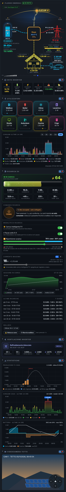
</p>

> Le immagini di questa pagina sono generate dalla card vera con dati di esempio (`tools/screenshots/`) e vengono aggiornate a ogni versione.

---

## Indice

- [Cosa fa](#cosa-fa)
- [Installazione](#installazione)
- [Primi passi](#primi-passi)
  - [Aiuto nell'editor](#aiuto-nelleditor)
  - [Aprire i grafici di un'entità dalla card](#aprire-i-grafici-di-unentità-dalla-card)
- [Le sezioni della card](#le-sezioni-della-card)
  - [Flussi di energia](#flussi-di-energia)
  - [Tensioni, frequenza, autosufficienza e autoconsumo](#tensioni-frequenza-autosufficienza-e-autoconsumo)
  - [Casa a due falde](#casa-a-due-falde)
  - [Commutazione IN RETE / FUORI RETE](#commutazione-in-rete--fuori-rete)
  - [Riquadri giornalieri](#riquadri-giornalieri)
  - [Utilizzatori](#utilizzatori)
  - [Grafico dei consumi](#grafico-dei-consumi)
  - [Ventilazione inverter](#ventilazione-inverter)
  - [Statistiche](#statistiche)
  - [Videocamera](#videocamera)
  - [Cielo di notte e meteo](#cielo-di-notte-e-meteo)
  - [Statistiche batteria (JK BMS)](#statistiche-batteria-jk-bms)
  - [Auto elettrica / Wallbox](#auto-elettrica--wallbox)
  - [Ricarica EV](#ricarica-ev)
  - [Da telefono](#da-telefono)
  - [Menu a schede](#menu-a-schede)
  - [Sezioni richiudibili](#sezioni-richiudibili)
- [Esempio completo](#esempio-completo)
- [Riferimento delle opzioni](#riferimento-delle-opzioni)
- [Logica dei colori](#logica-dei-colori)
- [Prestazioni e modalità leggera](#prestazioni-e-modalità-leggera)
- [Aggiornamenti](#aggiornamenti)
- [Risoluzione dei problemi](#risoluzione-dei-problemi)
- [Registro delle modifiche](#registro-delle-modifiche)
- [Per chi sviluppa](#per-chi-sviluppa)

---

## Cosa fa

- **Flussi animati** a curve morbide con linee tratteggiate sottili e luminose: fotovoltaico → inverter → batteria / rete / casa / auto, con velocità e colori che seguono la potenza
- **Sole e luna** che si muovono su un arco in base all'ora reale (`sun.sun`), con alba e tramonto; di notte **cielo stellato** con stelle cadenti
- **Meteo animato** nel cielo: nuvole, pioggia, temporale, neve, nebbia e vento dalla tua entità `weather.*`
- **Batteria a segmenti** colorata in base al SOC, con scia che sale in carica e scende in scarica
- **Traliccio luminoso**: rosso quando prelevi, verde quando immetti, barrato quando sei fuori rete
- **Casa a due falde** con FV1 a sinistra e FV2 a destra, ognuna illuminata dalla propria produzione, con un **effetto calore** sui pannelli proporzionale alla potenza
- **Commutazione IN RETE / FUORI RETE** dalla card: tieni premuto, conferma, fatto
- **Utilizzatori** con icona, colore e un disco stile contatore Ferraris che gira in base al consumo
- **Grafico dei consumi** delle ultime 24 ore: chi ha consumato e quando
- **Statistiche**: produzione FV di oggi per stringa con la stima, consumi della casa con i picchi, batteria nelle 24 ore
- **Videocamera** in diretta con le frecce per muovere una telecamera ONVIF
- **Ventilazione inverter** con livelli termici, temperature, PWM e ventole animate
- **Autonomia** fino a un SOC minimo a scelta (es. 20%) e **tempo alla ricarica**, energia residua, barra delle fonti di energia, modalità EMS
- **Wallbox e auto** disegnate accanto alla casa, con stato, potenza, SOC dell'auto e tempo alla carica completa
- **Ricarica EV**: scheda dedicata per wallbox OCPP (es. JuiceBox) con avvio/stop **protetto** (un solo comando, tieni premuto + conferma), carica intelligente FV, ripartizione del surplus, corrente massima in A o W, grafico della sessione e ultime ricariche
- **Leggibile anche da telefono**: se la card è stretta, i riquadri vanno su 3 colonne e le etichette si ingrandiscono
- **Menu a schede** con la goccia luminosa animata, oppure **sezioni richiudibili** con riepilogo su una riga e flag 📌
- Supporto per **due batterie** e **stringhe FV aggiuntive** (FV3 sulla falda sinistra, FV4 sulla destra)
- **Editor visuale** completo in italiano: non serve scrivere YAML
- Un solo file JavaScript, nessuna dipendenza

Funziona con qualsiasi integrazione che esponga sensori di potenza ed energia: nata per GoodWe + JK BMS, usata con Deye e Sigenergy.

---

## Installazione

### Con HACS (consigliato)

1. In Home Assistant apri **HACS**, premi **⋮** in alto a destra → **Repository personalizzati**.
2. Incolla `https://github.com/fabiustek/f-flow-card`, categoria **Dashboard**, poi **Aggiungi**.
3. Cerca **F-Flow Card** in HACS e premi **Scarica**.
4. Ricarica il browser forzando l'aggiornamento: `Ctrl + Shift + R` (Windows/Linux) o `Cmd + Shift + R` (Mac). Nell'app per telefono, chiudila e riaprila.

HACS registra la risorsa da solo e ti avvisa quando esce una nuova versione.

### Manuale

1. Copia il contenuto della cartella `dist/` (`f-flow-card.js` e le icone PNG) in `/config/www/community/f-flow-card/`.
2. In **Impostazioni → Plance → ⋮ → Risorse → Aggiungi risorsa** inserisci:
   ```yaml
   url: /local/community/f-flow-card/f-flow-card.js
   type: module
   ```
3. Ricarica il browser.

---

## Primi passi

1. Apri una plancia, premi **Modifica** → **Aggiungi card** e cerca **F-Flow Card** (oppure usa una card manuale con `type: custom:f-flow-card`).
2. Nell'editor visuale apri le sezioni una alla volta e scegli i tuoi sensori:
   - **⚙️ Generale**: nome dell'inverter, capacità della batteria (in Ah o kWh), potenze massime.
   - **☀️ Fotovoltaico** e **☀️ Altri dati fotovoltaico**: potenze delle stringhe, totale, produzione e consumo di oggi.
   - **🔌 Rete**: potenza della rete, energia prelevata e immessa.
   - **🔋 Batteria principale**: SOC, potenza, corrente, tensione.
3. Se un valore va al contrario (per esempio la batteria risulta in scarica mentre si carica), usa l'interruttore **Inverti segno** nella sezione della rete o della batteria.
4. Se non sai cosa inserire in un campo, tocca il **?** accanto al suo nome: si apre la spiegazione (vedi [Aiuto nell'editor](#aiuto-nelleditor)).
5. Attiva le sezioni che ti servono: **🎨 Layout e intestazione**, **🔌 Utilizzatori**, **🌀 Ventilazione inverter**, **🚗 Auto elettrica / Wallbox**.

Tutte le funzioni aggiuntive sono facoltative: se non le attivi, non compaiono.

### Aiuto nell'editor

<p align="center">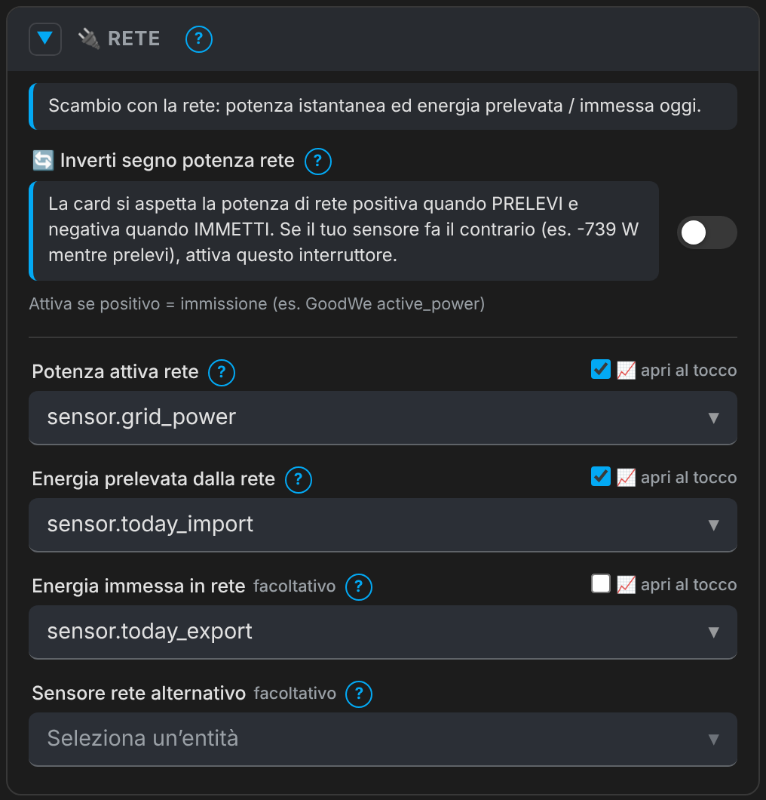</p>

Accanto al nome di ogni campo, interruttore e sezione dell'editor c'è un **?**:
- **toccalo** (anche da telefono o tablet) per aprire sotto il campo la spiegazione di cosa inserire, con esempi; toccalo di nuovo per chiuderla;
- dal computer la stessa spiegazione compare anche **passando il mouse** sopra il **?**.

### Aprire i grafici di un'entità dalla card

Accanto alle entità che compaiono nella card c'è la casella **📈 apri al tocco**. Se la spunti, toccando quel valore nella card si apre la finestra di Home Assistant con i dettagli e i **grafici** dell'entità (la "more-info"). Per esempio, spuntandola su **Consumo casa** e toccando la casa (o il valore sotto) vedi il grafico del consumo.

Funziona per: produzione FV (etichetta vicino al sole) e stringhe FV1–FV4, potenza ed energie della rete (traliccio e valori), consumo casa (casa e valore), batteria (icona, potenza, corrente, tensione), temperatura e riquadro dell'inverter, riquadri giornalieri, riquadri JK BMS, wallbox (potenza, SOC, stato), scheda **Ricarica EV** (potenza, corrente, tensione, temperatura, energia e durata della sessione, SOC, stato), indicatore IN RETE / FUORI RETE, badge EMS e valori della ventilazione. Per gli **utilizzatori** e le **ventole** la casella è dentro ogni elemento dell'elenco (gli utilizzatori la hanno attiva di partenza, come prima).

Sull'indicatore della rete e sul badge EMS il **tocco breve** apre la scheda, mentre **tenere premuto** continua ad aprire la commutazione o la scelta della modalità.

---

## Le sezioni della card

### Flussi di energia

<p align="center">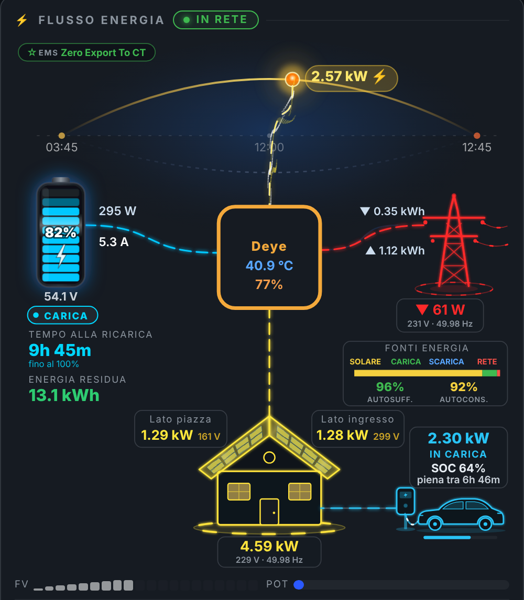</p>

- **In alto**: titolo e indicatore **IN RETE / FUORI RETE**. La **modalità EMS** (se configurata) è un piccolo badge nel cielo, in alto a sinistra sopra l'arco del sole.
- **Arco del sole**: alba, mezzogiorno e tramonto di oggi; l'etichetta gialla mostra la produzione fotovoltaica totale.
- **Batteria** a sinistra: SOC, tensione, potenza e corrente, stato **CARICA / SCARICA / RIPOSO**. La scia bianca nella batteria sale quando si carica e scende quando si scarica.
- **Pannello autonomia** sotto la batteria, allineato al badge:
  - in **scarica** mostra **AUTONOMIA**: il tempo che resta fino al **SOC minimo** che scegli (es. "2h 36m · fino al 20%");
  - in **carica** mostra **TEMPO ALLA RICARICA**: il tempo per arrivare al **SOC obiettivo** (es. "fino al 100%");
  - a riposo mostra "batteria a riposo". Sotto c'è l'**energia residua** in kWh.
- **Flussi**: curve morbide con linee tratteggiate sottili e luminose che scorrono nella direzione dell'energia, più veloci quando la potenza sale. Il flusso della batteria è sempre blu, come la batteria.
- **Inverter** al centro: temperatura e percentuale di carico. Si può sostituire con una foto (`inverter_image`).
- **Rete** a destra: potenza istantanea, energia prelevata (▼) e immessa (▲) oggi e, se configurate, **tensione e frequenza di rete** sotto la potenza. Sotto, la barra **Fonti energia** mostra in proporzione solare, carica, scarica e rete, con sotto l'**autosufficienza** e l'**autoconsumo** di oggi.
- **Casa**: consumo istantaneo sotto la casa e, se configurate, **tensione e frequenza erogate**, nello stesso riquadro.
- **Riquadri**: ogni gruppo di informazioni (rete, fonti energia, stringhe, casa, wallbox) ha un suo riquadro sottile, così si capisce a cosa appartiene ogni valore. Accanto alla potenza di ogni stringa può comparire la sua **tensione**.
- **Barre FV / POT**: produzione rispetto alla potenza massima dell'impianto e potenza della batteria rispetto a quella dell'inverter.

Nella sezione **🎨 Layout e intestazione** puoi cambiare titolo, attivare la barra delle fonti, il pannello autonomia, l'immagine dell'inverter e tornare alle icone classiche (batteria, rete, casa).

**Modalità EMS** (sezione **🎨 Layout e intestazione** → **Modalità EMS / di lavoro**): scegli l'entità della modalità di lavoro dell'inverter (per Deye di solito un `select` "Work mode"). Compare come badge nel cielo. Se l'entità è un `select` o un `input_select`, **tieni premuto il badge** circa un secondo: si apre l'elenco delle modalità disponibili, con quella attuale segnata; scegline una e premi **Applica** (la card usa `select.select_option`). Con **Annulla** non cambia nulla.

**Sfondo trasparente** (sezione **🎨 Layout e intestazione**):
- **Opacità dello sfondo della card**: 100 = pieno (predefinito), 0 = completamente trasparente; per esempio 60 lascia intravedere lo sfondo della plancia.
- **Sfoca ciò che sta dietro la card**: effetto vetro smerigliato, utile con sfondi molto colorati.

**Autonomia fino a un SOC minimo** (sezione **⚙️ Generale**):
1. **SOC minimo per l'autonomia** (`battery_reserve_soc`): per esempio `20` se l'inverter non scarica la batteria sotto il 20%. L'autonomia viene calcolata solo sull'energia sopra quella soglia. Con `0` (predefinito) arriva fino a batteria vuota.
2. **SOC obiettivo per il tempo alla ricarica** (`battery_target_soc`): per esempio `100`, oppure `90` se carichi fino al 90%.
3. Serve anche la **capacità della batteria** nella stessa sezione.

Esempio: SOC 45%, soglia 20%, batteria da 16 kWh, scarica a 1533 W → 25% di 16 kWh = 4 kWh utilizzabili → **2h 36m**.

### Tensioni, frequenza, autosufficienza e autoconsumo

<p align="center"></p>

Tutti facoltativi: se non configuri un'entità, quella scritta non compare.

**Autosufficienza e autoconsumo** (sotto la barra **Fonti energia**, su due colonne centrate):
- **Autosufficienza**: quanta parte del consumo di oggi **non** è arrivata dalla rete = (consumo oggi − prelievo oggi) ÷ consumo oggi. Verde dal 70%, arancione dal 40%, rosso sotto.
- **Autoconsumo**: quanta parte della produzione FV di oggi è stata **usata** (in casa o in batteria) invece di essere immessa = (produzione FV oggi − immissione oggi) ÷ produzione FV oggi.
- La card li calcola da sola con le entità che hai già: **Produzione FV oggi** e **Consumo oggi** (sezione ☀️ Altri dati fotovoltaico), **Energia prelevata** ed **Energia immessa** (sezione 🔌 Rete). Se hai già sensori in % puoi usarli in **🔌 Rete** → **Autosufficienza %** / **Autoconsumo %**.
- Si spengono in **🎨 Layout e intestazione** → **Autosufficienza e autoconsumo** (servono la barra fonti energia attiva).

**Tensione e frequenza**:
1. Sezione **🔌 Rete** → **Tensione di rete** e **Frequenza di rete**: compaiono sotto la potenza prelevata/ceduta, es. "231 V · 49.98 Hz".
2. Sezione **☀️ Altri dati fotovoltaico** → **Tensione erogata alla casa** e **Frequenza erogata alla casa**: compaiono accanto al consumo sotto la casa.

**Tensione e nome delle stringhe** (sezione **☀️ Fotovoltaico**):
1. **Tensione FV1** / **Tensione FV2** (e FV3/FV4 nelle stringhe aggiuntive): in piccolo **accanto alla potenza** della stringa, sulla stessa riga (es. "1.29 kW 161 V"), così non si sovrappone alle falde.
2. **Nome della falda** (`pv1_name`, `pv2_name`): per esempio **Lato piazza** e **Lato ingresso** al posto di FV1 e FV2. Il nome compare sul disegno e nelle statistiche.

Esempio per Deye (controlla i nomi esatti in **Strumenti per sviluppatori → Stati**):

```yaml
pv1_name: Lato piazza
pv2_name: Lato ingresso
pv1_voltage: sensor.deye_pv1_voltage
pv2_voltage: sensor.deye_pv2_voltage
grid_voltage: sensor.deye_grid_voltage
grid_frequency: sensor.deye_grid_frequency
load_voltage: sensor.deye_load_voltage
load_frequency: sensor.deye_load_frequency
```

### Casa a due falde

La casa ha due falde di pannelli: **FV1 sulla sinistra** e **FV2 sulla destra**. Quando una stringa produce, la sua **falda diventa gialla** (come il flusso dal sole all'inverter) e i pannelli si illuminano tanto più quanto più produce; nome e potenza sono scritti in alto, accanto alla falda. Sotto la casa c'è il consumo istantaneo, e l'**anello alla base gira più veloce quanto più la casa consuma** (fermo sotto i 10 W). La casa (con il flusso che arriva dall'inverter, l'anello e il valore del consumo) prende il **colore delle fonti che la alimentano, mescolate in proporzione**: **giallo** per il solare, **blu** per la batteria, **rosso** per la rete. Per esempio, se la casa prende il 60% dal solare e il 40% dalla rete diventa arancione; metà solare e metà batteria dà un verde chiaro. La quota solare è la produzione FV che resta dopo la carica della batteria e l'immissione in rete. Le finestre si accendono quando c'è consumo.

**Effetto calore sulle falde** (dalla v1.15.0, attivo di partenza): quando una falda produce, i suoi pannelli **tremolano come l'aria sopra l'asfalto d'estate** e onde di luce gialla risalgono lentamente la falda dalla gronda al colmo, come il calore che sale. Il colore resta il giallo dei pannelli. L'effetto è **proporzionale alla produzione di ogni falda**: più la stringa produce, più il tremolio è forte e le onde sono luminose e veloci; a 0 W sparisce. Si spegne in **🎨 Layout e intestazione** → **Effetto calore sulle falde** (`roof_heat: false`); in modalità leggera non c'è e si ferma quando la card non si vede.

**Stringhe aggiuntive FV3 e FV4**: attivale nella sezione **☀️ Stringhe FV aggiuntive** (＋ Attiva). **FV3** compare sotto FV1, sul lato della falda sinistra; **FV4** sotto FV2, sul lato della falda destra. Ogni falda si illumina con la somma delle sue stringhe (sinistra FV1 + FV3, destra FV2 + FV4). Con l'icona casa classica, FV3 e FV4 restano nella colonna di sinistra.

Se nel tuo impianto le stringhe sono al contrario, basta scambiare i sensori FV1 e FV2 nella sezione **☀️ Fotovoltaico**. Lì puoi anche dare il **nome che vuoi** a ogni falda/stringa, in base al tuo impianto (per esempio l'orientamento o "Garage"): compare accanto alla casa e nelle statistiche. Se lasci il campo vuoto resta **FV1**, **FV2**… Per tornare all'immagine vecchia: **Icona casa classica** (`home_icon_style: classic`).

### Commutazione IN RETE / FUORI RETE

<p align="center">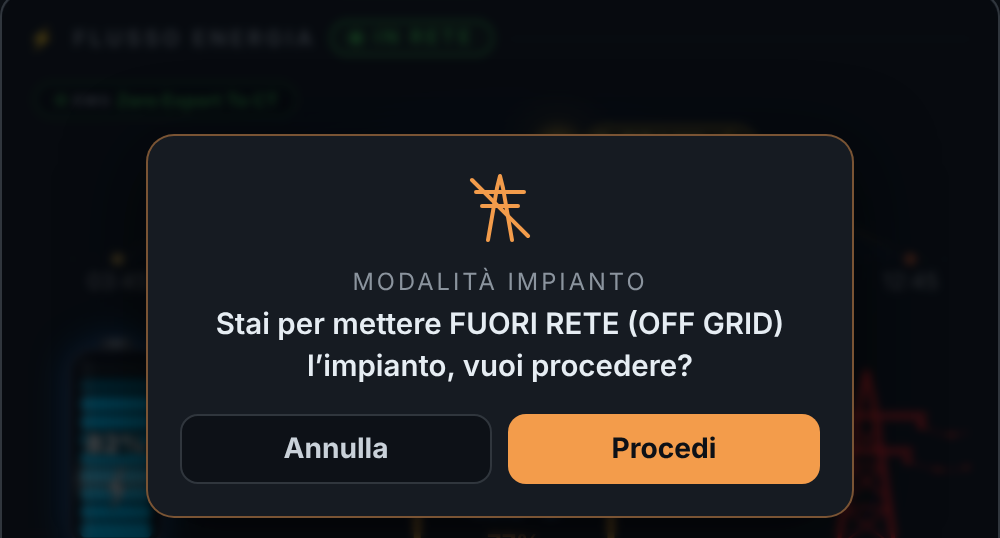</p>

Se l'impianto può staccarsi e riattaccarsi alla rete (per esempio con un modulo di sgancio e riaggancio), puoi comandarlo dalla card.

**Configurazione** (sezione **🎨 Layout e intestazione**):

| Opzione | Esempio | Cosa fa |
|---|---|---|
| Stato rete (`grid_status_entity`) | `binary_sensor.deye_grid` | `on` = in rete, `off` = fuori rete |
| Comando per passare FUORI RETE (`grid_switch_to_off`) | `switch.studio_off_grid` | Viene attivato per staccarsi |
| Comando per tornare IN RETE (`grid_switch_to_on`) | `switch.studio_on_grid` | Viene attivato per riattaccarsi |
| Chiedi conferma (`grid_switch_confirm`) | `true` | Mostra la richiesta di conferma |

**Come si usa:**
1. **Tieni premuto** per circa un secondo l'indicatore **IN RETE / FUORI RETE** in alto, oppure il traliccio. Una barra si riempie mentre tieni premuto. Un tocco breve non fa nulla, così non si commuta per sbaglio.
2. Compare la richiesta di conferma: **Procedi** oppure **Annulla**.
3. Con **Procedi** la card attiva l'entità giusta (`switch.turn_on` per gli switch, `button.press` per i pulsanti, `script.turn_on` per gli script).
4. Finché lo stato non cambia, l'indicatore mostra **COMMUTAZIONE…**. Fuori rete il traliccio diventa grigio e barrato.

Con il mouse, passando sopra l'indicatore compare il suggerimento ("Tieni premuto per passare FUORI RETE").

### Riquadri giornalieri

Sotto i flussi ci sono i totali di oggi. Con **6 riquadri giornalieri** attivo (`_daily_tiles_extended`) vedi: produzione FV, carica batteria, scarica batteria, prelievo dalla rete, immissione e consumo. Altrimenti la versione da 4 riquadri mostra anche l'energia residua della batteria. Il titolo della sezione usa il **nome dell'inverter** (es. "Deye Inverter").

### Utilizzatori

<p align="center">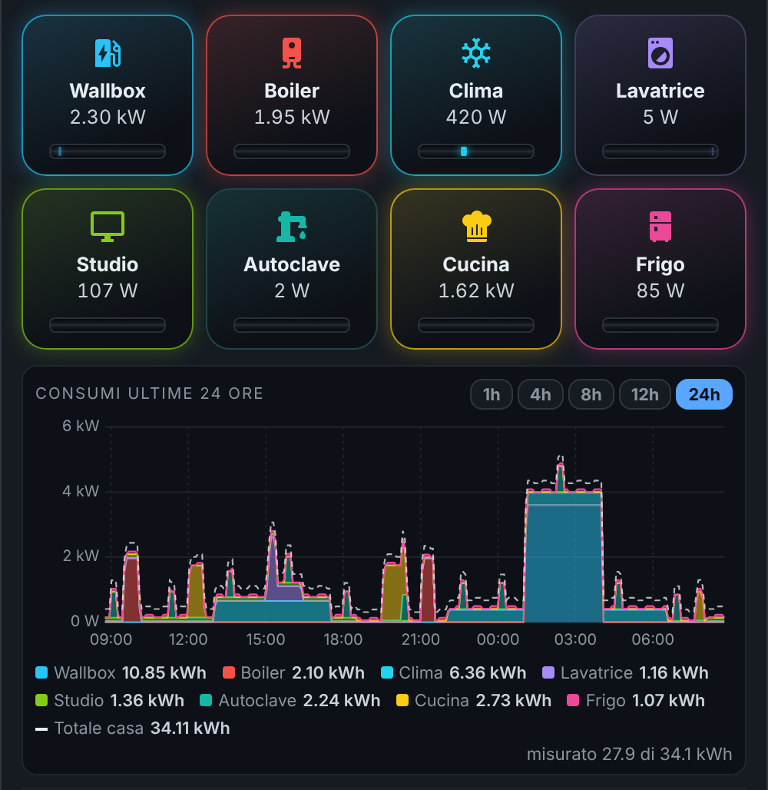</p>

Un riquadro per ogni elettrodomestico, quanti ne vuoi.

1. Sezione **🔌 Utilizzatori** → **＋ Attiva** → **＋ Aggiungi utilizzatore**.
2. Per ognuno scegli **nome**, **sensore di potenza** (W o kW), **icona** (qualsiasi icona `mdi:`, con ricerca), **colore** e **soglia "acceso"** (predefinita 50 W).
3. Clicca sul nome di un utilizzatore per aprirlo o chiuderlo; con **▲ ▼** cambi l'ordine, con **✕** lo togli.

Nella card:
- Quando il consumo supera la soglia, il riquadro si illumina del suo colore.
- Sotto ogni riquadro c'è un **disco contatore** stile Ferraris: la tacca gira più veloce quando il consumo sale e si ferma a 0 W. La velocità di tutti i dischi si regola con **Velocità dischi contatore**.
- Toccando un riquadro si apre la scheda dell'entità.

### Grafico dei consumi

<p align="center">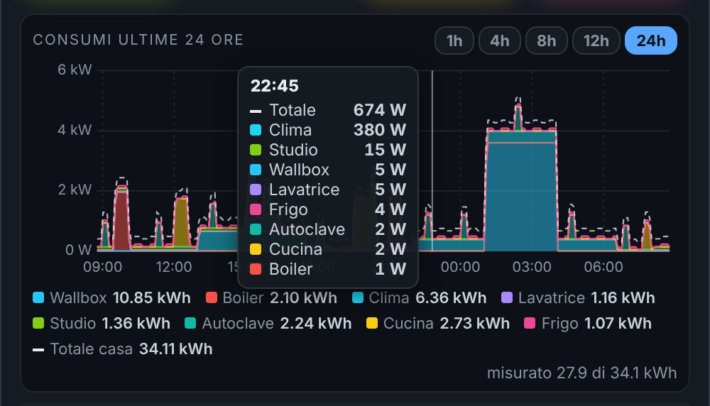</p>

Sotto gli utilizzatori c'è il grafico dei consumi. Ogni utilizzatore è un'**area del suo colore**, impilata sulle altre: si vede subito **cosa ha consumato e quando**.

- **Periodo a vista**: con i pulsanti **1h · 4h · 8h · 12h · 24h** in alto a destra del grafico cambi il periodo con un tocco. La scelta viene ricordata su quel dispositivo. Il valore di **Ore mostrate all'apertura** nell'editor (predefinito 24) vale finché non premi un pulsante.
- Con periodi brevi il grafico è più dettagliato: una media al minuto per 1 ora, ogni 2 minuti fino a 4 ore, ogni 4 minuti fino a 8 ore, poi ogni 5 minuti.
- **Legenda**: per un grafico più compatto togli la spunta **Legenda sotto il grafico** nella sezione **🔌 Utilizzatori** dell'editor. Il totale "misurato X di Y kWh" resta visibile.

- I dati arrivano dallo **storico di Home Assistant** (recorder) e si aggiornano ogni 5 minuti.
- La **linea tratteggiata** è il consumo totale della casa (sensore **Consumo casa**): lo spazio tra le aree e la linea è il consumo non misurato.
- **Tocca il grafico** (o passaci sopra col mouse) per vedere l'orario e i watt di ogni utilizzatore, dal più alto al più basso.
- Sotto il grafico, la legenda riporta i **kWh** di ciascuno nel periodo; in alto, "misurato X di Y kWh".

> Se tra gli utilizzatori hai anche il totale della casa (es. "Casa"), apri il suo elemento nell'editor e togli la spunta **Mostra nel grafico**, altrimenti verrebbe contato due volte.

### Ventilazione inverter

<p align="center">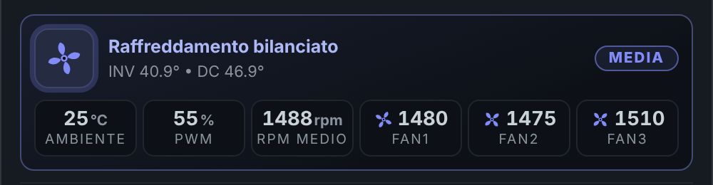</p>

Per chi ha una ventilazione ausiliaria dell'inverter. Sezione **🌀 Ventilazione inverter** → **＋ Attiva**. Tutti i sensori sono facoltativi.

| Campo | Esempio |
|---|---|
| Stato termico | `sensor.controller_fan_inverter_controller_fan_inverter_thermal_state` |
| Descrizione stato | vuoto = testo automatico dal livello |
| Temperatura ambiente | `sensor.clima_studio_room_temperature` |
| PWM ventole | `sensor.controller_fan_inverter_controller_fan_inverter_pwm_percentage` |
| RPM medio | vuoto = media delle ventole |
| Temperatura inverter | `sensor.deye_temperature` (vuoto = quella della sezione FV) |
| Temperatura DC | `sensor.deye_dc_temperature` |
| Ventole (＋ Aggiungi ventola) | nome + sensore rpm, es. `..._fan_1_rpm` |

Ogni livello termico ha il suo colore, testo e velocità della ventola principale; le piccole ventole girano in base ai loro giri reali.

| Stato | Badge | Testo |
|---|---|---|
| `idle` | Inattiva | Sistema in attesa (ventola barrata, ferma) |
| `cool` | Minima | Ventilazione minima attiva |
| `low` | Bassa | Raffreddamento leggero |
| `medium` | Media | Raffreddamento bilanciato |
| `high` | Alta | Ventilazione sostenuta |
| `very high` | Molto alta | Ventilazione intensa |
| `critical` | Critica | Temperatura critica, massima ventilazione (triangolo di avviso) |

Se lo stato ha un valore diverso, la card lo mostra così com'è.

### Statistiche

<p align="center">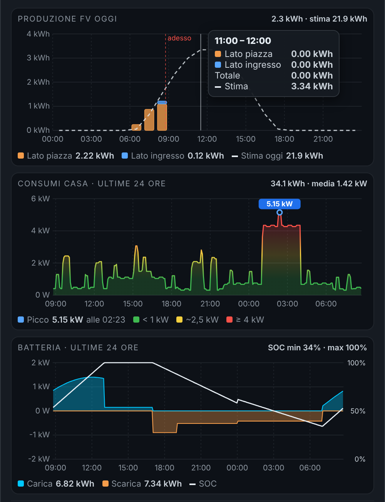</p>

Sezione **📈 Statistiche** → **＋ Attiva**. Ci sono tre grafici, ognuno attivabile o disattivabile; i dati arrivano dallo storico di Home Assistant e si aggiornano ogni 5 minuti. Toccando un grafico (o passandoci sopra col mouse) compare il dettaglio di quell'orario. Come le altre sezioni, si può chiudere e ha il flag 📌.

**1. Produzione FV oggi**
- Una barra per ogni ora della giornata, da mezzanotte a mezzanotte; ogni barra è divisa per stringa con colori fissi: **FV1 arancione, FV2 blu, FV3 viola, FV4 verde**. L'altezza è l'energia prodotta in quell'ora (kWh).
- La linea rossa tratteggiata indica **adesso**.
- **Stima**: scegli il tuo sensore in **Sensore di stima produzione**. La card lo usa così:
  - se il sensore ha la previsione nelle **attributi** (Solcast `detailedForecast` / `detailedHourly`, oppure un attributo `watts` come Forecast.Solar), disegna la curva tratteggiata della stima per **tutta la giornata**, anche le ore future, e mostra il totale stimato;
  - se è un sensore di **potenza** (W o kW, es. "Forecast +1h"), disegna la curva dal suo storico fino ad adesso;
  - se è un sensore di **energia** (kWh), mostra solo il totale stimato in alto.
- In alto: kWh prodotti oggi e stima; sotto: kWh per stringa.

**2. Consumi casa · ultime 24 ore**
- Usa il sensore **Consumo casa**. La linea e l'area cambiano colore con la potenza: **verde** sotto 1 kW, **giallo** intorno a 2,5 kW, **rosso** da 4 kW in su.
- Il **picco** è segnato con un cerchio e il valore; sotto c'è l'orario del picco. In alto: kWh consumati nelle 24 ore e potenza media.

**3. Batteria · ultime 24 ore**
- Area **blu** sopra lo zero quando la batteria si carica, **arancione** sotto lo zero quando si scarica; la linea bianca è il **SOC** (scala in % a destra).
- In alto: SOC minimo e massimo; sotto: kWh caricati e scaricati.

### Videocamera

<p align="center">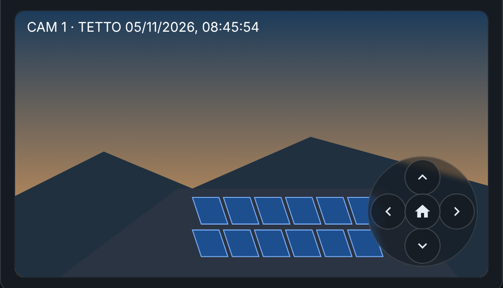</p>

Sezione **📹 Videocamera** → **＋ Attiva**:
1. **Videocamera**: scegli la tua entità `camera.*`. Il video in diretta usa il lettore di Home Assistant (lo stesso delle card ufficiali: HLS, WebRTC o MJPEG, in base a cosa supporta la videocamera).
2. Se il video non parte, o per consumare meno dati, attiva **Solo immagine**: la card mostra un'immagine aggiornata ogni 10 secondi.
3. **Frecce ▲ ▼ ◀ ▶**, due modi:
   - **ONVIF diretto (consigliato)**: in **Telecamera ONVIF da muovere** scegli l'entità `camera.*` dell'integrazione ONVIF che si muove (può essere diversa da quella del video). Le frecce chiamano il servizio `onvif.ptz` con `pan: LEFT/RIGHT` o `tilt: UP/DOWN`, `move_mode: ContinuousMove`, con **Velocità** (predefinita 1) e **Durata/ampiezza di ogni passo** (predefinita 0.3). Non servono altre entità. Facoltativo: un **preset** per il pulsante centrale (es. `1`).
   - **Entità**: in alternativa, per ogni freccia scegli un pulsante, script o switch che muove la telecamera, e per il pulsante centrale **Posizione iniziale**.

Esempio con l'integrazione ONVIF (video da un NVR, movimento sulla telecamera):
```yaml
_show_camera: true
camera_entity: camera.nvr_camera_tetto_sub
ptz_camera: camera.camera_tetto_profile000
ptz_speed: 1
ptz_distance: 0.3
```

Nella card le frecce compaiono sopra il video, in basso a destra. **Un tocco** manda un comando (un passo di movimento); **tenendo premuto** il comando si ripete ogni mezzo secondo finché non lasci. La card usa `button.press` per i pulsanti, `script.turn_on` / `switch.turn_on` per script e switch. Compaiono solo le frecce configurate.

### Cielo di notte e meteo

<p align="center">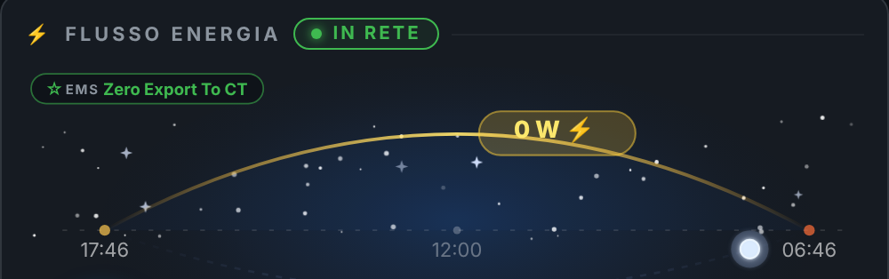<br>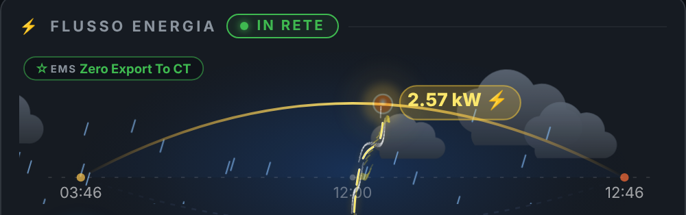</p>

- **Di notte** (dal tramonto all'alba, da `sun.sun`) il cielo si riempie di **stelle** che brillano, con una **stella cadente** ogni tanto. Non serve configurare nulla.
- **Meteo**: in **🎨 Layout e intestazione** scegli la tua entità **Meteo** (`weather.*`, per esempio quella di Met.no o di OpenWeatherMap). Il cielo si anima in base alle condizioni:

| Condizione | Animazione |
|---|---|
| sereno (`sunny`, `clear-night`) | cielo libero (stelle di notte) |
| poco nuvoloso (`partlycloudy`) | due nuvole che passano; stelle un po' velate |
| nuvoloso (`cloudy`) | più nuvole; il sole si attenua, le stelle quasi spariscono |
| pioggia (`rainy`) / acquazzone (`pouring`) | nuvole scure e gocce (più fitte con l'acquazzone) |
| temporale (`lightning`, `lightning-rainy`) | nuvole scure, lampi e fulmini (con pioggia se `lightning-rainy`) |
| neve (`snowy`), neve e pioggia, grandine | fiocchi che scendono ondeggiando |
| nebbia (`fog`) | banchi di nebbia che scorrono |
| vento (`windy`) | folate che attraversano il cielo |

### Statistiche batteria (JK BMS)

<p align="center">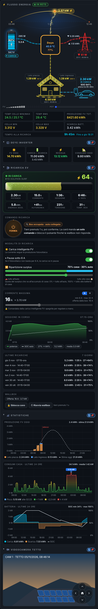</p>

Con **Riquadri statistiche batteria** attivo (predefinito) compaiono: temperatura celle min/max, temperatura BMS, produzione FV totale, tensione cella minima e massima, scarica di oggi e il riquadro **autonomia** con l'orario stimato ("Fino a lun 21:45"). Le etichette si possono rinominare nella sezione **🏷️ Etichette**, che permette anche di mostrare un'altra entità al posto di quella predefinita.

### Auto elettrica / Wallbox

<p align="center">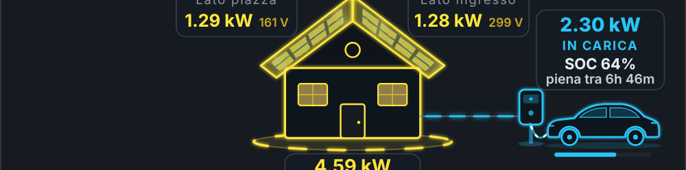</p>

A destra della casa, staccate dalle stringhe FV2/FV4, compaiono la **colonnina** e l'**auto**. Tra casa e colonnina c'è sempre una linea grigia; quando l'auto si carica diventa un flusso azzurro e il cavo si anima. Sopra l'auto ci sono la potenza di ricarica, lo stato, il SOC dell'auto (anche come barra sotto l'auto), la corrente e il tempo alla carica completa.

**Configurazione** (sezione **🚗 Auto elettrica / Wallbox** → **＋ Attiva**):
1. **Potenza wallbox**: il sensore di potenza della wallbox o della presa (W o kW). È l'unico campo necessario.
2. **Stato wallbox** (facoltativo): se lo lasci vuoto, la card considera l'auto **in carica** quando la potenza supera 50 W.
3. **SOC batteria auto** (facoltativo): per esempio il livello batteria dall'integrazione della tua auto.
4. **Corrente wallbox** e **Tempo alla carica completa** (facoltativi).
5. **Capacità batteria auto** in Wh (facoltativa): se non hai un sensore del tempo residuo, la card lo stima da capacità, SOC e potenza. Per esempio 43,2 kWh → `43200`.

Stati riconosciuti (non importano maiuscole e minuscole):

| Stato della wallbox | Nella card | Colore |
|---|---|---|
| contiene `charging`, `ricarica`, `in carica` | IN CARICA | azzurro |
| contiene `complete`, `finished`, `full` | CARICA COMPLETA | verde |
| contiene `connected`, `plugged`, `waiting`, `paused`, `ready` | COLLEGATA | giallo |
| altro (es. `disconnected`, `idle`) | SCOLLEGATA | grigio |
| nessuno stato configurato e potenza ≤ 50 W | IN ATTESA | grigio |

### Ricarica EV

<p align="center">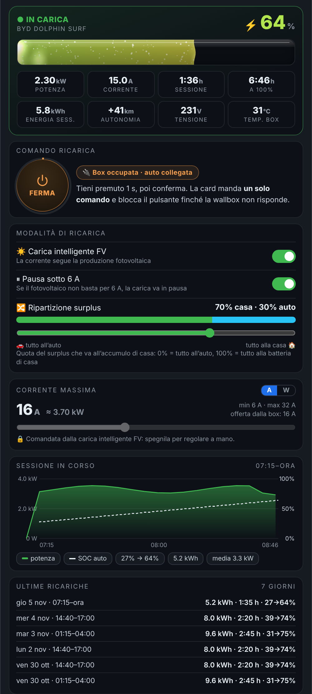</p>

Una scheda dedicata alla **ricarica dell'auto** con una wallbox **OCPP** (pensata per JuiceBox con l'integrazione OCPP, funziona con qualsiasi wallbox che esponga entità simili). Dall'alto in basso:

- **Stato e batteria dell'auto**: stato del connettore tradotto in italiano (Scollegata, Collegata, In carica, In pausa, Completata, Errore…), nome dell'auto e una **barra a liquido** sottile, come un **tubo di vetro** che si riempie fino al SOC: in alto c'è il riflesso del vetro, dentro un liquido torbido che si muove lentamente con bollicine fini che salgono, e il bordo del liquido ondeggia appena. Quando l'auto carica il liquido è più vivace (in proporzione alla potenza di carica), quando non assorbe è calmo. Il colore cambia **in modo continuo** con il livello: **rosso** sotto il 10%, **arancione** verso il 25%, **giallo** a metà, **verde** verso l'80% e **acquamarina** al 100%. Il ⚡% ha lo stesso colore. **Quando apri la scheda** il tubo si riempie da 0 al SOC e il numero conta in su. L'animazione si ferma quando la scheda è chiusa o la card non si vede, rallenta da sola sui dispositivi lenti e in modalità leggera è ferma.
- **8 riquadri**: potenza, corrente, durata della sessione, tempo al 100%, energia della sessione, **km aggiunti** (energia ÷ consumo dell'auto), tensione e temperatura della wallbox.
- **Comando ricarica** protetto (vedi sotto), con accanto il badge della **disponibilità della box**: **Box disponibile** (verde) quando nessuna auto è collegata, **Box occupata · auto collegata** (arancione) quando c'è l'auto.
- **Modalità di ricarica**: interruttori **Carica intelligente FV** e **Pausa sotto 6 A**, e il cursore **Ripartizione surplus**: il valore è la quota del surplus che va alla **batteria di casa** (0% = tutto all'auto, 100% = tutto all'accumulo di casa). Nella barra il verde a sinistra è la casa, l'azzurro a destra l'auto.
- **Corrente massima** con il cursore e il selettore **A / W** (i watt sono calcolati come A × tensione × fasi). Mentre la carica intelligente FV è accesa il cursore è **bloccato** 🔒, perché la corrente la decide l'automazione: spegnila per regolare a mano.
- **Sessione in corso**: grafico della potenza con la linea tratteggiata del SOC dell'auto, SOC iniziale → attuale, energia e potenza media.
- **Ultime ricariche** degli ultimi 7 giorni, ricavate dallo storico della potenza: giorno, orario, energia, durata e SOC da → a.
- **Wallbox**: corrente offerta, eventuale codice di errore (nascosto se è `NoError`) e i pulsanti **Sblocca cavo** e **Riavvia wallbox**.

#### Comando protetto: un solo comando alla wallbox

<p align="center">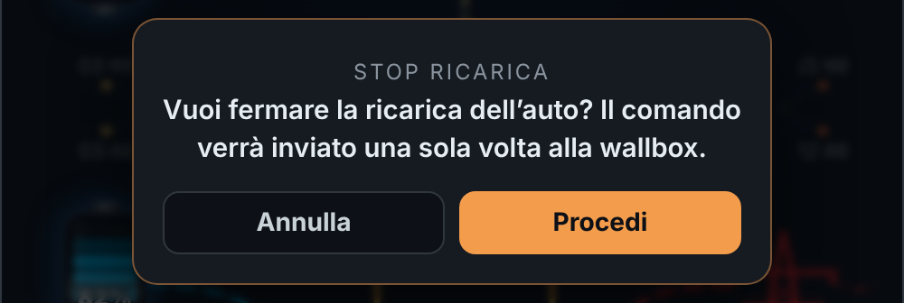</p>

Alcune wallbox si bloccano se ricevono più comandi di fila. Per questo il pulsante **AVVIA / FERMA** funziona così:
1. Il **tocco breve non fa nulla**: bisogna **tenere premuto 1 secondo** (un anello si riempie intorno al pulsante).
2. Compare la **conferma**. Solo con **Procedi** la card invia **un solo comando** (`switch.turn_on` per avviare, `switch.turn_off` per fermare).
3. Il pulsante resta **bloccato** ("ATTESA") finché lo stato dell'interruttore non arriva al valore richiesto **e resta stabile per 3 secondi**. Se l'interruttore torna indietro per un momento (con JuiceBox spesso torna su *off* e si riaccende quando la wallbox conferma), la card continua ad aspettare e **non invia altri comandi**.
4. Se la conferma non arriva entro l'**attesa massima** (60 s di partenza) il pulsante si sblocca e compare "Nessuna conferma dalla wallbox: controlla lo stato e riprova".
5. Il pulsante è disattivato solo se l'entità **Comando ricarica** è `unavailable` o `unknown` in Home Assistant. Lo stato di **Comando ricarica** dice se la funzione di ricarica è accesa (*on* → il pulsante mostra **FERMA**) o spenta (*off* → **AVVIA**).

**Sblocca cavo** e **Riavvia wallbox** seguono lo stesso percorso (tieni premuto 1 s + conferma) e dopo l'invio restano bloccati per 15 secondi. Gli interruttori ignorano i doppi tocchi e i cursori inviano il valore **solo quando lasci il dito**.

#### Configurazione passo passo

Nell'editor apri **⚡ Ricarica EV** → **＋ Attiva**, poi:
1. **Nome dell'auto** (facoltativo), es. `BYD Dolphin Surf`.
2. **Comando ricarica**: l'interruttore che avvia e ferma la carica, es. `switch.juicebox_charge_control`.
3. **Stato del connettore OCPP** (es. `sensor.juicebox_status_connector`) e, se vuoi, **Disponibilità box** (es. `switch.juicebox_availability`): acceso = box libera, spento = auto collegata. Compare come badge accanto al pulsante e non blocca il comando.
4. **Attesa massima della conferma**: quanti secondi aspettare la risposta della wallbox (10–300, predefinito 60).
5. **Potenza di ricarica**: il sensore più affidabile che hai (es. `sensor.consumi_wallbox`). Se lo lasci vuoto usa **Potenza wallbox** della sezione 🚗.
6. Corrente, tensione, temperatura, energia e durata della sessione (tutti facoltativi). La durata può essere in secondi, minuti, ore o `h:mm:ss`.
7. **Batteria dell'auto %**: se vuoto usa il **SOC batteria auto** della sezione 🚗. **Consumo medio** (predefinito 14 kWh/100 km) per i km aggiunti.
8. **Carica intelligente FV**, **Pausa sotto 6 A** (`input_boolean`), **Quota del surplus all'accumulo di casa** (`input_number`, 0% = tutto all'auto), **Corrente massima manuale** (`number`) e **Corrente offerta dalla wallbox**.
9. **Fasi**: 1 per monofase, 3 per trifase (serve per passare da A a W).
10. **Codice di errore**, **Sblocca cavo** e **Riavvio wallbox** (pulsanti `button.*`).

La scheda compare nel menu (o tra le sezioni impilate) con il nome **Ricarica EV**; puoi spostarla, rinominarla e cambiarne l'icona in **🎨 Layout e intestazione** → **Sezioni sotto il disegno**. La sezione 🚗 Auto elettrica / Wallbox nel disegno dei flussi resta indipendente.

Esempio YAML con JuiceBox (OCPP):

```yaml
_show_evc: true
evc_car_name: BYD Dolphin Surf
evc_charge_switch: switch.juicebox_charge_control
evc_availability: switch.juicebox_availability
evc_status: sensor.juicebox_status_connector
evc_power: sensor.consumi_wallbox
evc_current: sensor.juicebox_current_import
evc_voltage: sensor.juicebox_voltage
evc_temp: sensor.juicebox_temperature
evc_session_energy: sensor.juicebox_energy_session
evc_session_time: sensor.juicebox_time_session
evc_offered_current: sensor.juicebox_current_offered
evc_error: sensor.juicebox_error_code
evc_pv_auto: input_boolean.wb_pv_auto
evc_pause_enabled: input_boolean.wb_pause_enabled
evc_share: input_number.wb_battery_share_pct
evc_max_current: number.juicebox_maximum_current
evc_unlock: button.juicebox_unlock
evc_reset: button.juicebox_reset
evc_phases: 1
evc_consumption: 14
```

### Menu a schede

<p align="center">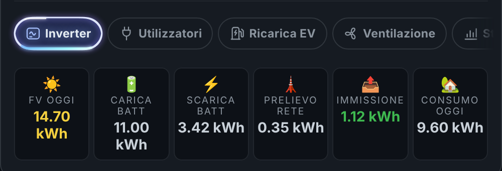<br>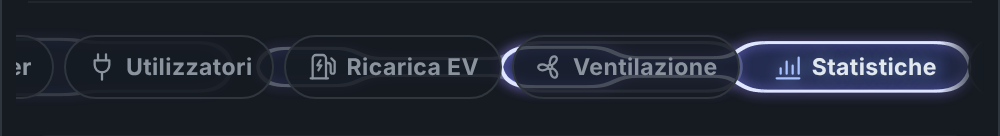</p>

Sotto il disegno dei flussi c'è una **barra di schede**, una per ogni sezione attiva: Batteria, Inverter, Utilizzatori, Ricarica EV, Ventilazione, Statistiche, Video (nell'ordine scelto in **Ordine delle sezioni**).

- **All'apertura della pagina le sezioni sono chiuse**: tocca una scheda per aprirla. Si apre una sezione alla volta; toccando di nuovo la scheda aperta la chiudi.
- **Animazione**: la scheda attiva è segnata da una **bolla di vetro liquido** con bordo argentato e alone viola. **A riposo** un riflesso **perlescente** (rosa, viola, azzurro) le gira continuamente intorno. **Quando cambi scheda** la bolla si comporta come una goccia: il bulbo davanti corre verso la nuova scheda schiacciandosi per la velocità, dietro resta una coda che si assottiglia con un collo sottile in mezzo, e qualche contorno sfumato fa da scia; all'arrivo fa un piccolo rimbalzo gelatinoso. È un filtro SVG "gooey" mosso da una simulazione a molle. Il contenuto entra scorrendo dal lato della nuova scheda e l'altezza della card si adatta con un'animazione.
- Le schede e i titoli delle sezioni usano **icone a linea** (batteria, inverter, spina, colonnina, ventola, grafico, videocamera) invece delle emoji.
- Se le schede non stanno in una riga (per esempio su telefono), la barra si scorre col dito; dal computer con la **rotella del mouse** (passandoci sopra) oppure **trascinandola** tenendo premuto il tasto sinistro.

Nell'editor, in **🎨 Layout e intestazione**:
- **Menu a schede: all'apertura della pagina** → *Tutte chiuse* (predefinito), *Riapri l'ultima scheda usata* (ricordata su quel dispositivo) oppure *Apri sempre* una sezione a scelta.
- **Sezioni impilate (vecchio stile)** → torna alle sezioni una sotto l'altra, richiudibili con il flag 📌 (vedi sotto).

### Sezioni richiudibili

Con **Sezioni impilate (vecchio stile)** attivo:

<p align="center">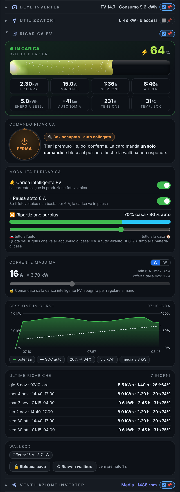</p>

Le sezioni **Inverter** (riquadri giornalieri), **Utilizzatori** e **Ventilazione inverter** si aprono e si chiudono toccando il titolo. Da chiuse occupano una sola riga, con un riepilogo:
- **Inverter**: produzione FV e consumo di oggi.
- **Utilizzatori**: potenza totale degli utilizzatori e quanti sono accesi.
- **Ventilazione**: livello termico e giri medi, con il colore del livello.

Il flag **📌** a destra decide come si presenta la sezione quando apri o ricarichi la pagina:
- **📌 spuntato**: la sezione si apre **sempre aperta** (bloccata aperta).
- **📌 senza spunta**: puoi aprirla quando vuoi, ma a ogni ricaricamento della pagina la trovi **chiusa**.

**Ordine, nome e icona delle sezioni**: in **🎨 Layout e intestazione** → **Sezioni sotto il disegno** sposti con **▲ ▼** le parti sotto il disegno dei flussi; sotto ogni riga puoi scrivere il **nome** da mostrare sulla scheda (e nel titolo delle sezioni impilate) e scegliere un'**icona** `mdi:` al posto di quella disegnata. Lasciando vuoti restano nome e icona predefiniti. Le parti sono: statistiche batteria (JK BMS), Inverter, Utilizzatori e grafico, Ricarica EV, Ventilazione, Statistiche, Videocamera. Le sezioni non attive non compaiono nella card ma tengono il loro posto nell'elenco.

Di partenza tutte le sezioni hanno il flag spuntato, quindi la card si presenta come prima finché non togli la spunta. Il flag e la scelta delle ore del grafico vengono salvati **sul dispositivo** (nel browser o nell'app): sul telefono e sul computer puoi avere impostazioni diverse.

### Da telefono

<p align="center">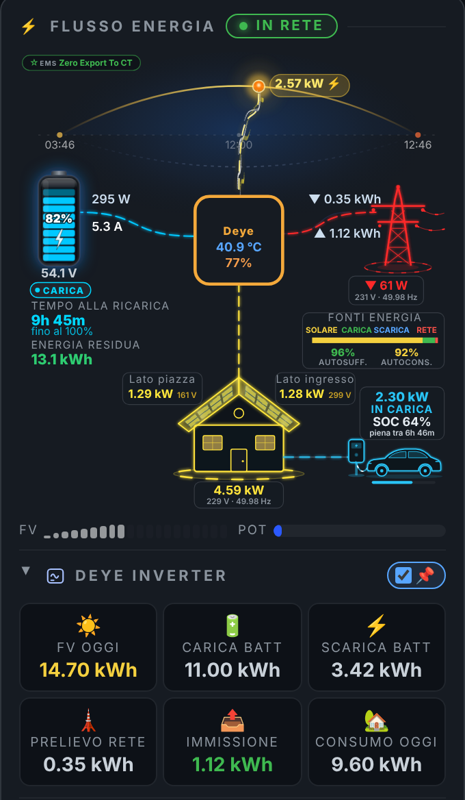</p>

La card si adatta alla **propria larghezza**, non a quella dello schermo: se è stretta (sotto 440 px, come su un telefono o in una colonna stretta della plancia), i 6 riquadri giornalieri vanno su 3 colonne e le etichette del disegno (orari, autonomia, FV1/FV2, wallbox…) diventano più grandi.

---

## Esempio completo

La configurazione della demo nelle immagini, con nomi di entità di esempio:

```yaml
type: custom:f-flow-card
card_title: Flusso Energia
inverter_name: Deye

# Fotovoltaico e casa
pv_total_power: sensor.pv_power
pv1_power: sensor.pv1_power
pv2_power: sensor.pv2_power
consump: sensor.load_power
inv_temp: sensor.inverter_temp
today_pv: sensor.today_pv
today_load: sensor.today_load
pv_max_power: 6000
inverter_max_power: 6000

# Rete
grid_active_power: sensor.grid_power
grid_import_energy: sensor.today_import
grid_export_energy: sensor.today_export
grid_status_entity: binary_sensor.deye_grid
grid_switch_to_off: switch.studio_off_grid
grid_switch_to_on: switch.studio_on_grid
ems_mode_entity: select.ems_mode

# Batteria
battery_soc: sensor.battery_soc
battery_power: sensor.battery_power
battery_current: sensor.battery_current
battery_voltage: sensor.battery_voltage
today_batt_chg: sensor.today_batt_chg
batt_dis: sensor.today_batt_dis
battery_cap_unit: kwh
battery_full_wh: 16
battery_reserve_soc: 20
battery_target_soc: 100

# Layout
_show_energy_supply: true
_show_backup_panel: true
_daily_tiles_extended: true
_show_battery_stats: false

# Wallbox e auto
_show_ev: true
charger_power: sensor.wallbox_power
charger_soc: sensor.auto_livello_batteria
charger_battery_capacity_wh: 43200

# Ricarica EV (scheda dedicata, wallbox OCPP)
_show_evc: true
evc_car_name: BYD Dolphin Surf
evc_charge_switch: switch.juicebox_charge_control
evc_availability: switch.juicebox_availability
evc_status: sensor.juicebox_status_connector
evc_power: sensor.consumi_wallbox
evc_pv_auto: input_boolean.wb_pv_auto
evc_pause_enabled: input_boolean.wb_pause_enabled
evc_share: input_number.wb_battery_share_pct
evc_max_current: number.juicebox_maximum_current

# Utilizzatori e grafico
_show_consumers: true
consumers:
  - name: Boiler
    entity: sensor.boiler_power
    icon: mdi:water-boiler
    color: "#f85149"
  - name: Lavatrice
    entity: sensor.lavatrice_power
    icon: mdi:washing-machine
    color: "#a78bfa"
  - name: Cucina
    entity: sensor.cucina_power
    icon: mdi:chef-hat
    color: "#facc15"
    threshold: 200

# Ventilazione inverter
_show_ventilation: true
vent_state_entity: sensor.controller_fan_inverter_controller_fan_inverter_thermal_state
vent_ambient_temp: sensor.clima_studio_room_temperature
vent_pwm: sensor.controller_fan_inverter_controller_fan_inverter_pwm_percentage
vent_inv_temp: sensor.deye_temperature
vent_dc_temp: sensor.deye_dc_temperature
vent_fans:
  - name: FAN1
    entity: sensor.controller_fan_inverter_controller_fan_inverter_fan_1_rpm
  - name: FAN2
    entity: sensor.controller_fan_inverter_controller_fan_inverter_fan_2_rpm
  - name: FAN3
    entity: sensor.controller_fan_inverter_controller_fan_inverter_fan_3_rpm
```

---

## Riferimento delle opzioni

Tutte le opzioni si impostano dall'editor visuale; qui trovi le chiavi YAML corrispondenti. Le chiavi che iniziano con `_` sono interruttori che mostrano o nascondono parti della card.

### Generale e layout

| Chiave | Predefinito | Descrizione |
|---|---|---|
| `card_title` | `Flusso Energia` | Titolo nell'intestazione |
| `inverter_name` | `''` | Nome nel riquadro dell'inverter e nel titolo dei riquadri giornalieri |
| `inverter_image` | `''` | URL di un'immagine al posto del riquadro INV (es. `/local/inverter.png`) |
| `ems_mode_entity` | `''` | Modalità EMS: badge nel cielo; se è un `select`/`input_select`, tenendolo premuto si cambia |
| `performance_mode` | `normal` | `normal`, `light` (modalità leggera) o `auto` (leggera solo su dispositivi lenti / "riduci movimento") |
| `background_opacity` | `100` | Opacità dello sfondo della card (0–100 %) |
| `background_blur` | `false` | Sfoca ciò che sta dietro la card (vetro smerigliato) |
| `weather_entity` | `''` | Entità meteo per le animazioni del cielo |
| `battery_cap_unit` | `ah` | Unità della capacità batteria: `ah` o `kwh` |
| `battery_full_ah` | `0` | Capacità in Ah (se `ah`) |
| `battery_full_wh` | `0` | Capacità **in kWh** (se `kwh`) |
| `battery_reserve_soc` | `0` | SOC minimo (%) fino a cui calcolare l'autonomia |
| `battery_target_soc` | `100` | SOC obiettivo (%) per il tempo alla ricarica |
| `pv_max_power` | `7500` | Potenza massima dell'impianto FV (W) |
| `inverter_max_power` | `6000` | Potenza massima dell'inverter (W) |
| `_show_energy_supply` | `false` | Barra delle fonti di energia |
| `_show_backup_panel` | `false` | Pannello autonomia ed energia residua |
| `_daily_tiles_extended` | `false` | 6 riquadri giornalieri invece di 4 |
| `_show_battery_stats` | `true` | Riquadri statistiche batteria (JK BMS) |
| `battery_style` | `modern` | `modern` (a segmenti) o `classic` |
| `sections_layout` | `tabs` | `tabs` (menu a schede) o `stack` (sezioni impilate) |
| `tabs_start` | `none` | Menu a schede all'apertura: `none` (tutte chiuse), `last` (ultima usata) o il nome di una sezione (`inv`, `cons`…) |
| `section_names` | `{}` | Nome personalizzato per scheda/sezione, es. `{inv: Il mio Deye, cons: Elettrodomestici}` |
| `section_icons` | `{}` | Icona `mdi:` per scheda/sezione, es. `{cons: mdi:fridge}` |
| `more_info` | `[]` | Entità che aprono la scheda di Home Assistant al tocco nella card (chiavi della configurazione, es. `[consump, battery_soc]`) |
| `sections_order` | `[bms, inv, cons, evc, vent, stats, cam]` | Ordine delle sezioni sotto il disegno (bms = statistiche batteria, inv = Inverter, cons = Utilizzatori, evc = Ricarica EV, vent = Ventilazione, stats = Statistiche, cam = Videocamera) |
| `grid_icon_style` | `modern` | `modern` (traliccio luminoso) o `classic` (immagine) |
| `home_icon_style` | `modern` | `modern` (casa a due falde) o `classic` (immagine) |
| `roof_heat` | `true` | Effetto calore (superficie rovente) sulle falde in produzione, proporzionale alla potenza di ogni falda |
| `sun` | `sun.sun` | Entità del sole |

### Fotovoltaico e casa

| Chiave | Predefinito | Descrizione |
|---|---|---|
| `pv1_power` / `pv2_power` | sensori GoodWe | Potenza delle stringhe FV1 (falda sinistra) e FV2 (falda destra) |
| `pv1_name` … `pv4_name` | `''` | Nome libero delle falde/stringhe (es. `Lato piazza`); se vuoto `FV1`, `FV2`… |
| `pv1_voltage` … `pv4_voltage` | `''` | Tensione delle stringhe (V), accanto alla potenza |
| `_show_pv_extra` | `false` | Mostra le stringhe FV3 e FV4 |
| `pv3_power` / `pv4_power` | `''` | Potenza delle stringhe FV3 (sotto FV1, falda sinistra) e FV4 (sotto FV2, falda destra) |
| `pv_total_power` | `sensor.goodwe_pv_power` | Potenza FV totale (se vuota: somma delle stringhe) |
| `today_pv` | `sensor.goodwe_today_s_pv_generation` | Produzione di oggi (kWh) |
| `total_pv_gen_entity` | `sensor.goodwe_total_pv_generation` | Produzione totale (kWh) |
| `inv_temp` | `sensor.goodwe_inverter_temperature_module` | Temperatura dell'inverter |
| `consump` | `sensor.goodwe_house_consumption` | Consumo della casa (W) |
| `today_load` | `sensor.goodwe_today_load` | Consumo di oggi (kWh) |
| `load_voltage` / `load_frequency` | `''` | Tensione (V) e frequenza (Hz) erogate alla casa, accanto al consumo |

### Rete

| Chiave | Predefinito | Descrizione |
|---|---|---|
| `grid_active_power` | `sensor.goodwe_active_power` | Potenza della rete (W) |
| `grid_power_alt` | `sensor.grid_phase_a_power` | Sensore alternativo se il primo non è disponibile |
| `invert_grid_power` | `false` | Inverte il segno (se positivo = immissione) |
| `grid_import_energy` | `sensor.goodwe_today_energy_import` | Energia prelevata oggi (kWh) |
| `grid_export_energy` | `''` | Energia immessa oggi (kWh) |
| `grid_voltage` / `grid_frequency` | `''` | Tensione (V) e frequenza (Hz) di rete, sotto la potenza |
| `_show_self_stats` | `true` | Autosufficienza e autoconsumo di oggi sotto la barra fonti energia |
| `self_sufficiency_entity` / `self_consumption_entity` | `''` | Sensori in % da usare al posto del calcolo della card |
| `grid_status_entity` | `''` | Stato IN RETE / FUORI RETE |
| `grid_switch_to_off` | `''` | Entità da attivare per passare fuori rete |
| `grid_switch_to_on` | `''` | Entità da attivare per tornare in rete |
| `grid_switch_confirm` | `true` | Chiede conferma prima di commutare |

### Batterie

| Chiave | Predefinito | Descrizione |
|---|---|---|
| `_show_battery` | `true` | Mostra la batteria principale |
| `battery_soc` | `sensor.jk_soc` | Stato di carica (%) |
| `battery_power` | `sensor.jk_power` | Potenza (W) |
| `battery_current` | `sensor.jk_current` | Corrente (A) |
| `battery_voltage` | `sensor.jk_voltage` | Tensione (V) |
| `invert_battery_power` | `false` | Inverte il segno (se positivo = scarica) |
| `today_batt_chg` | `sensor.goodwe_today_battery_charge` | Carica di oggi (kWh) |
| `batt_dis` | `sensor.goodwe_today_battery_discharge` | Scarica di oggi (kWh) |
| `battery_temp1` / `battery_temp2` | `sensor.jk_temp1` / `sensor.jk_temp2` | Sonde temperatura celle |
| `battery_mos` | `sensor.jk_mos` | Temperatura del BMS |
| `battery_min_cell` / `battery_max_cell` | `sensor.jk_cellmin` / `sensor.jk_cellmax` | Tensione cella minima e massima |
| `goodwe_battery_soc` / `goodwe_battery_curr` | sensori GoodWe | SOC e corrente di riserva |
| `_show_battery2` | `false` | Attiva la batteria secondaria |
| `battery2_soc`, `battery2_power`, `battery2_current`, `battery2_voltage`, `battery2_mos` | `''` | Sensori della batteria secondaria |
| `battery2_full_ah` / `battery2_full_wh` | `0` | Capacità della batteria 2, se diversa dalla 1 |

### Utilizzatori e grafico

| Chiave | Predefinito | Descrizione |
|---|---|---|
| `_show_consumers` | `false` | Mostra la sezione |
| `consumers_title` | `Utilizzatori` | Titolo della sezione |
| `consumers_meter_speed` | `1` | Velocità dei dischi contatore (0.1–5) |
| `consumers` | `[]` | Elenco con `name`, `entity`, `icon`, `color`, `threshold` (W), `chart` (`false` per escluderlo dal grafico), `more_info` (`false` per non aprire la scheda al tocco) |
| `consumers_chart` | `true` | Mostra il grafico dei consumi |
| `consumers_chart_hours` | `24` | Ore mostrate all'apertura (1–72); poi si cambiano con i pulsanti sul grafico |
| `consumers_chart_legend` | `true` | Legenda sotto il grafico (`false` per un grafico più compatto) |
| `consumers_chart_total` | `true` | Linea tratteggiata del consumo totale (`consump`) |

### Statistiche

| Chiave | Predefinito | Descrizione |
|---|---|---|
| `_show_stats` | `false` | Mostra la sezione Statistiche |
| `stats_pv` | `true` | Grafico produzione FV di oggi |
| `stats_forecast_entity` | `''` | Sensore di stima produzione (Solcast, Forecast.Solar, potenza o energia) |
| `stats_load` | `true` | Grafico consumi casa ultime 24 ore (sensore `consump`) |
| `stats_battery` | `true` | Grafico batteria ultime 24 ore (`battery_power`, `battery_soc`) |

### Videocamera

| Chiave | Predefinito | Descrizione |
|---|---|---|
| `_show_camera` | `false` | Mostra la sezione |
| `camera_title` | `Videocamera` | Titolo della sezione |
| `camera_entity` | `''` | Entità `camera.*` |
| `camera_mode` | `live` | `live` (video in diretta) o `snapshot` (immagine ogni 10 s) |
| `ptz_up` / `ptz_down` / `ptz_left` / `ptz_right` | `''` | Entità da attivare per ogni freccia |
| `ptz_home` | `''` | Entità per la posizione iniziale (pulsante centrale) |
| `ptz_camera` | `''` | Telecamera ONVIF da muovere con `onvif.ptz` (se impostata, le frecce non hanno bisogno di entità) |
| `ptz_speed` | `1` | Velocità del movimento ONVIF (0.1–1) |
| `ptz_distance` | `0.3` | Durata/ampiezza di ogni passo ONVIF (0.1–1) |
| `ptz_move_mode` | `ContinuousMove` | Modalità di movimento ONVIF |
| `ptz_home_preset` | `''` | Preset ONVIF per il pulsante centrale |

### Ventilazione inverter

| Chiave | Descrizione |
|---|---|
| `_show_ventilation` | Mostra la sezione |
| `vent_title` | Titolo (predefinito `Ventilazione inverter`) |
| `vent_state_entity` | Stato termico: `idle`, `cool`, `low`, `medium`, `high`, `very high`, `critical` |
| `vent_status_entity` | Descrizione dello stato (se vuota: testo automatico) |
| `vent_ambient_temp` | Temperatura ambiente |
| `vent_pwm` | PWM delle ventole (%) |
| `vent_rpm_avg` | RPM medio (se vuoto: media delle ventole) |
| `vent_inv_temp` | Temperatura inverter (se vuota: `inv_temp`) |
| `vent_dc_temp` | Temperatura DC |
| `vent_fans` | Elenco ventole con `name`, `entity` (rpm) e `more_info` (`true` per aprire la scheda al tocco) |

### Auto elettrica / Wallbox

| Chiave | Descrizione |
|---|---|
| `_show_ev` | Mostra la sezione |
| `charger_power` | Potenza della wallbox (W o kW) — **necessario** |
| `charger_state` | Stato (`charging`, `completed`, `connected`…). Facoltativo: se vuoto, "in carica" quando la potenza supera 50 W |
| `charger_current` | Corrente (A) |
| `charger_soc` | SOC della batteria dell'auto (%) |
| `charger_eta` | Minuti alla carica completa (facoltativo) |
| `charger_battery_capacity_wh` | Capacità della batteria dell'auto (Wh), per stimare il tempo |

### Ricarica EV

| Chiave | Predefinito | Descrizione |
|---|---|---|
| `_show_evc` | `false` | Mostra la scheda Ricarica EV |
| `evc_car_name` | `''` | Nome dell'auto sotto lo stato |
| `evc_charge_switch` | `''` | Interruttore della funzione di ricarica (on = attiva): la card lo accende/spegne con un solo comando, tieni premuto + conferma. Se è `unavailable` il comando è bloccato |
| `evc_availability` | `''` | Disponibilità della box: `on` = libera (nessuna auto), `off` = auto collegata. Badge accanto al pulsante, non blocca il comando |
| `evc_status` | `''` | Stato del connettore OCPP (`Available`, `Preparing`, `Charging`, `SuspendedEV`, `SuspendedEVSE`, `Finishing`, `Faulted`…) |
| `evc_confirm_timeout` | `60` | Secondi di attesa della conferma prima di sbloccare il pulsante |
| `evc_power` | `''` | Potenza di ricarica (W o kW); se vuoto usa `charger_power` |
| `evc_current` | `''` | Corrente di ricarica (A) |
| `evc_voltage` | `''` | Tensione (V); se manca si usano 230 V per passare da A a W |
| `evc_temp` | `''` | Temperatura della wallbox |
| `evc_session_energy` | `''` | Energia della sessione (kWh o Wh) |
| `evc_session_time` | `''` | Durata della sessione (s, min, h, d oppure `h:mm:ss`) |
| `evc_soc` | `''` | SOC dell'auto (%); se vuoto usa `charger_soc` |
| `evc_consumption` | `14` | Consumo medio dell'auto in kWh/100 km, per i km aggiunti |
| `evc_pv_auto` | `''` | Carica intelligente FV (`input_boolean`/`switch`); quando è accesa blocca la corrente manuale |
| `evc_pause_enabled` | `''` | Pausa sotto 6 A (`input_boolean`/`switch`) |
| `evc_share` | `''` | Quota del surplus che va alla batteria di casa in % (`input_number`/`number`): 0% = tutto all'auto |
| `evc_max_current` | `''` | Corrente massima manuale (`number`/`input_number`), mostrata in A o W |
| `evc_offered_current` | `''` | Corrente offerta dalla wallbox (A) |
| `evc_phases` | `1` | Fasi dell'impianto (1 o 3), per il calcolo A → W |
| `evc_error` | `''` | Codice di errore (nascosto se `NoError`) |
| `evc_unlock` | `''` | Sblocca cavo (`button`, `script` o `switch`), con conferma |
| `evc_reset` | `''` | Riavvio wallbox (`button`, `script` o `switch`), con conferma |

### Etichette

| Chiave | Predefinito | Descrizione |
|---|---|---|
| `_labels_custom_entities` | `false` | Attiva la sezione Etichette |
| `label_cell_temp_minmax` | `TEMP CELLE MIN/MAX` | Etichetta temperatura celle |
| `label_bms_temp` | `TEMP BMS` | Etichetta temperatura BMS |
| `label_min_cell` / `label_max_cell` | `Cella Min` / `Cella Max` | Etichette tensione celle |
| `label_batt_dis` | `Scarica Batt.` | Etichetta scarica batteria |
| `label_total_pv_gen` | `PRODUZIONE FV TOT.` | Etichetta produzione FV totale |
| `label_endurance` | `AUTONOMIA` | Etichetta autonomia |
| `label_entity_*` | `''` | Entità alternativa per il riquadro corrispondente |
| `label_custom1` / `label_custom2` | `''` | Testo dei due **campi liberi** (es. `CICLI BATTERIA`) |
| `label_entity_custom1` / `label_entity_custom2` | `''` | Entità dei due campi liberi: compaiono come riquadri in più tra le statistiche batteria |

**Campi liberi** (dalla v1.15.0): in fondo alla sezione **🏷️ Etichette** ci sono due campi in più, ognuno con un testo e un'entità a scelta (per esempio *CICLI BATTERIA* con `sensor.jk_cycles` e *SOH BATTERIA* con `sensor.jk_soh`). Compaiono come riquadri in più sotto le statistiche batteria (serve **Riquadri statistiche batteria** attivo); un campo senza entità non compare. Il valore è mostrato con la sua unità e si può aprire al tocco con 📈.

Nella sezione Etichette la scelta di un'entità alternativa si sblocca solo dopo aver cambiato il testo dell'etichetta; il sensore corrispondente nella sezione Batteria viene allora bloccato, per evitare doppioni.

---

## Logica dei colori

| Elemento | Colori |
|---|---|
| **Batteria (SOC)** | ≤20% rosso · ≤40% arancione · ≤75% verde · >75% azzurro |
| **Rete** | rosso prelievo · verde immissione · grigio a riposo · barrato fuori rete |
| **Casa e flusso verso la casa** | miscela in proporzione delle fonti: giallo solare · blu batteria · rosso rete (es. solare + rete = arancione) |
| **Temperatura celle** | ≤15°C blu · ≤35°C verde · ≤45°C arancione · >45°C rosso |
| **Tensione celle** | <3,0 V rosso · <3,1 V arancione · <3,4 V giallo · ≤3,65 V verde · >3,65 V rosso |
| **Ventilazione** | da grigio (idle) ad azzurro, blu, indaco, viola, fino a magenta (critical) |
| **Flusso batteria** | sempre blu; la direzione dei trattini indica carica o scarica |
| **Statistiche** | FV1 arancione · FV2 blu · FV3 viola · FV4 verde · consumi verde → giallo → rosso · batteria blu carica / arancione scarica |
| **Autosufficienza / autoconsumo** | autosufficienza verde ≥70% · arancione ≥40% · rosso sotto; autoconsumo giallo |
| **Wallbox e auto** | azzurro in carica · verde carica completa · giallo collegata · grigio scollegata / in attesa |
| **Ricarica EV (liquido e ⚡%)** | sfumatura continua: rosso (0–10%) → arancione (25%) → giallo (45%) → lime (60%) → verde (80%) → acquamarina (100%); comando: verde AVVIA · arancione FERMA · grigio in attesa / non disponibile |

---

## Prestazioni e modalità leggera

Dalla v1.12.0 la card è molto più leggera, **senza cambiare l'aspetto**:
- si aggiorna solo quando cambia uno dei **suoi** sensori (Home Assistant le segnala ogni cambiamento della casa), al massimo una volta al secondo;
- le animazioni usano il motore nativo del browser invece delle vecchie animazioni SVG, che obbligavano a ricalcolare tutta la card a ogni fotogramma;
- stelle e meteo esistono solo quando servono (prima giravano anche nascosti);
- quando la card **non si vede** (pagina scorsa, altra scheda del browser, vista nascosta) si mette in pausa, video compreso;
- la videocamera si collega solo quando la sua sezione è aperta.

Misure su un telefono di fascia bassa simulato (processore 6 volte più lento, 20 aggiornamenti al secondo da Home Assistant):

| Scenario | v1.11.1 | v1.12.0 normale | v1.12.0 leggera |
|---|---|---|---|
| Giorno, tutte le sezioni aperte | 4 fps | 40 fps | 58 fps |
| Giorno con pioggia, menu a schede chiuso | 4 fps | 59 fps | 60 fps |
| Notte stellata, menu a schede chiuso | 30 fps | 58 fps | 60 fps |
| Card fuori dallo schermo | 4 fps (consumava come visibile) | 60 fps (quasi nessun consumo) | 60 fps |

**Modalità leggera** — per tablet a muro datati o telefoni lenti. In **🎨 Layout e intestazione** → **Prestazioni**:
- **Normale** (predefinita): tutte le animazioni.
- **Leggera**: restano i **flussi animati** (sole, batteria, rete, casa, wallbox); spariscono bagliori, animazioni decorative (stelle che brillano, nuvole e pioggia in movimento, pulsazioni, scia nella batteria, dischi e ventole, effetto calore sulle falde), la goccia del menu a schede (resta una pillola evidenziata) e lo sfondo sfocato; la card si aggiorna ogni 3 secondi e i grafici ogni 15 minuti.
- **Automatica**: leggera solo sui dispositivi lenti (pochi processori o poca memoria) o con l'impostazione di sistema "riduci movimento", normale sugli altri. Utile se la stessa plancia si apre da dispositivi diversi.

## Aggiornamenti

A ogni nuova versione viene creata automaticamente una **release** su GitHub e HACS ti propone l'aggiornamento in Home Assistant. Dopo l'aggiornamento ricarica il browser con `Ctrl + Shift + R`.

Per sapere quale versione stai usando, apri la console del browser (`F12`): compare la scritta **F-FLOW-CARD v1.15.2**.

### Icona nella notifica di aggiornamento

HACS mostra un'icona accanto agli aggiornamenti **solo per le integrazioni** (la prende dal catalogo ufficiale dei loghi di Home Assistant); per le card della categoria Dashboard non ne passa nessuna. Per questo la card installa la sua icona in `/local/community/f-flow-card/icon.png`, e puoi assegnarla tu all'entità di aggiornamento:

1. In **Impostazioni → Dispositivi e servizi → Entità** cerca "F-Flow" e annota l'ID dell'entità di aggiornamento (di solito `update.f_flow_card_update`).
2. Aggiungi a `configuration.yaml` (se hai già una sezione `homeassistant:`, aggiungi solo la parte `customize:`):
   ```yaml
   homeassistant:
     customize:
       update.f_flow_card_update:
         entity_picture: /local/community/f-flow-card/icon.png
   ```
3. Riavvia Home Assistant, oppure in **Strumenti per sviluppatori → YAML** premi **Posizione e personalizzazioni**.

In alternativa, senza YAML: apri l'entità di aggiornamento → ⚙️ **Impostazioni** → **Icona** e scegli per esempio `mdi:solar-power-variant`.

---

## Risoluzione dei problemi

**La card non compare o dice "Custom element doesn't exist"**
- Controlla in **Impostazioni → Plance → Risorse** che ci sia `/hacsfiles/f-flow-card/f-flow-card.js` (HACS) o `/local/community/f-flow-card/f-flow-card.js` (manuale), tipo **Modulo JavaScript**.
- Ricarica con `Ctrl + Shift + R`; nell'app per telefono svuota la cache o chiudi e riapri l'app.
- Se arrivi da k-flow-card, cambia `type: custom:k-flow-card` in `type: custom:f-flow-card`.

**Traliccio e casa hanno ancora le immagini vecchie**
- Nella configurazione della card ci sono `grid_icon_style: classic` e/o `home_icon_style: classic`: nell'editor, in **🎨 Layout e intestazione**, disattiva **Icona rete classica** e **Icona casa classica** (oppure togli le due righe dal YAML). Se invece compaiono le stelle o la batteria a segmenti, la versione è sicuramente quella nuova.

**I riquadri della batteria mostrano `--` o non servono**
- Sono pensati per un BMS JK con temperature e tensioni delle celle. Se non li hai, disattiva **Riquadri statistiche batteria** in **🎨 Layout e intestazione**.

**L'energia residua sembra troppo bassa**
- Controlla la **capacità della batteria** in **⚙️ Generale**: in modalità kWh va scritta in kWh (es. `16` per 16 kWh), in modalità Ah in ampere-ora.

**Un valore mostra `--`**
- In **Strumenti per sviluppatori → Stati** controlla che l'entità esista e abbia un valore numerico (non `unavailable` o `unknown`). La card mostra `--` finché l'entità non torna valida.

**Un flusso va al contrario**
- Usa **Inverti segno** nella sezione Rete o Batteria.

**Il grafico dei consumi dice "Storico non disponibile"**
- Il grafico usa lo storico di Home Assistant: i sensori degli utilizzatori non devono essere esclusi dal `recorder`. Lo storico parte da quando il sensore esiste, quindi i primi giorni il grafico può essere vuoto in parte.

**La commutazione IN RETE / FUORI RETE non fa nulla**
- Servono sia **Stato rete** sia almeno uno dei due **Comandi**. Bisogna **tenere premuto** circa un secondo: il tocco breve è ignorato di proposito. Se lo stato rete è sconosciuto, la card non commuta.

**La wallbox mostra `--` o resta grigia**
- Controlla il sensore **Potenza wallbox**: è l'unico necessario. Senza **Stato wallbox**, la card mostra "IN CARICA" solo quando la potenza supera 50 W, altrimenti "IN ATTESA".
- Se hai configurato lo stato ma il valore non è tra quelli riconosciuti (vedi [Auto elettrica / Wallbox](#auto-elettrica--wallbox)), la card mostra "SCOLLEGATA": in quel caso lascia vuoto lo stato.

**Ricarica EV: il pulsante resta su "ATTESA"**
- È voluto: dopo il comando la card aspetta che **Comando ricarica** arrivi allo stato richiesto e ci resti 3 secondi, così non invia un secondo comando. Se la wallbox non risponde, dopo l'**attesa massima della conferma** (60 s di partenza) il pulsante si sblocca con un avviso. Controlla lo stato della wallbox prima di riprovare.

**Ricarica EV: potenza, corrente ed energia sono a 0 anche se le entità sono collegate**
- Di solito è giusto così: l'auto in quel momento **non assorbe** (carica arrivata al limite impostato sull'auto, auto in pausa, ricarica programmata). Con JuiceBox lo stato OCPP può restare *Charging* anche a 0 W: dalla v1.14.2 la card lo scrive come **IN CARICA · L'AUTO NON ASSORBE** in arancione, senza fulmine.
- La **tensione** viene misurata dalla wallbox solo mentre passa corrente: a 0 V la card mostra `--`.
- Per verificare, guarda le stesse entità in **Strumenti per sviluppatori → Stati**: la card mostra quei valori.
- **A 100%** resta `--` se manca la **Capacità batteria auto** nella sezione 🚗 Auto elettrica / Wallbox (es. `43200` per 43,2 kWh) o se l'auto non sta caricando.

**Ricarica EV: il pulsante è grigio e non si preme**
- L'entità **Comando ricarica** è `unavailable` o `unknown` in Home Assistant: l'integrazione OCPP non comunica con la wallbox. La **Disponibilità box** non blocca il comando: è solo il badge accanto al pulsante.

**Ricarica EV: la ripartizione sembra al contrario**
- Il valore di **Quota del surplus all'accumulo di casa** è la parte che va alla **casa**: 0% = tutto all'auto. Se la tua automazione usa il significato opposto, il cursore si comporta al contrario.

**Ricarica EV: il cursore della corrente è bloccato 🔒**
- La **Carica intelligente FV** è accesa e la corrente la regola l'automazione. Spegnila per impostare la corrente a mano.

**Ricarica EV: "Ultime ricariche" è vuoto**
- L'elenco nasce dallo storico del sensore di **Potenza di ricarica**: non deve essere escluso dal `recorder`. Con le statistiche a lungo termine (sensore con `state_class: measurement`) la card vede 7 giorni, altrimenti solo gli ultimi 2.

**Dal computer le schede a destra non si raggiungono**
- Dalla v1.14.1 la barra delle schede si scorre con la **rotella del mouse** passandoci sopra, oppure trascinandola col tasto sinistro premuto.

**Toccando un valore non si apre nulla**
- Spunta **📈 apri al tocco** accanto a quell'entità nell'editor. Sull'indicatore della rete e sul badge EMS il tocco deve essere breve: tenendo premuto si apre la commutazione / la scelta della modalità.

**La dashboard è lenta o il dispositivo scalda**
- Aggiorna almeno alla v1.12.0, che è molto più leggera a parità di aspetto.
- Sui dispositivi poco potenti imposta **Prestazioni → Leggera** (o **Automatica**) in **🎨 Layout e intestazione**.
- La videocamera in diretta è la parte più pesante: se serve solo ogni tanto, usa **Solo immagine**.

**Una sezione si apre sempre chiusa (o sempre aperta)**
- Dipende dal flag **📌** accanto al titolo della sezione: spuntato = sempre aperta, senza spunta = chiusa a ogni ricaricamento. Il flag è salvato su ogni dispositivo separatamente; in una finestra in incognito non viene ricordato.

**I testi sono troppo piccoli**
- Dalla v1.6.0 i caratteri sono più grandi e, quando la card è stretta, le etichette del disegno si ingrandiscono da sole. Se usi una plancia a più colonne, una colonna più larga rende tutto più leggibile.

**Le icone degli utilizzatori non si vedono**
- Usa nomi di icone `mdi:` validi (es. `mdi:washing-machine`); nell'editor puoi cercarle per nome.

**Autosufficienza o autoconsumo non compaiono o mostrano `--`**
- Servono la barra **Fonti energia** attiva e le energie di oggi: **Consumo oggi** + **Energia prelevata** per l'autosufficienza, **Produzione FV oggi** + **Energia immessa** per l'autoconsumo. A inizio giornata (energie quasi a zero) mostrano `--`.

**L'autonomia mostra `--`**
- Serve la capacità della batteria nella sezione **⚙️ Generale** e un sensore di potenza della batteria valido. Se la batteria è a riposo non c'è una stima ("batteria a riposo").

**La videocamera resta nera o dice "Videocamera non disponibile"**
- Controlla che l'entità `camera.*` funzioni in una card "Immagine" di Home Assistant. Se il video in diretta non parte, attiva **Solo immagine** nella sezione Videocamera.

**Le frecce della videocamera non muovono nulla**
- In modalità ONVIF diretta, **Telecamera ONVIF da muovere** deve essere l'entità `camera.*` dell'integrazione ONVIF (quella che usi con `onvif.ptz`), non quella dell'NVR. Prova il servizio `onvif.ptz` da **Strumenti per sviluppatori → Azioni** con la stessa entità.
- In modalità entità, ogni freccia deve essere collegata a un'entità che si può "premere" o accendere (pulsante, script, switch). Prova l'entità da **Strumenti per sviluppatori → Azioni**: se lì la telecamera si muove, funziona anche dalla card.

**Il meteo non si anima**
- Serve un'entità `weather.*` in **🎨 Layout e intestazione**. Lo stato deve essere uno di quelli standard di Home Assistant (es. `rainy`, `cloudy`); con stati diversi il cielo resta sereno.

**Le statistiche dicono "Storico non disponibile" o la stima non compare**
- I grafici usano lo storico di Home Assistant: i sensori non devono essere esclusi dal `recorder`.
- Per la curva della stima su tutta la giornata serve un sensore con la previsione negli attributi (es. Solcast "Forecast Today"). Con un sensore di energia (kWh) la card mostra solo il totale stimato.

**L'autonomia sembra troppo lunga o troppo corta**
- Controlla **SOC minimo per l'autonomia** in **⚙️ Generale**: deve corrispondere alla soglia sotto cui il tuo inverter non scarica la batteria. Se il SOC è già sotto la soglia, l'autonomia è 0.

**In carica o in scarica, la scia della batteria va nel verso sbagliato**
- La direzione segue il segno della potenza della batteria: se anche il badge CARICA/SCARICA è invertito, attiva **Inverti segno potenza batteria** nella sezione **🔋 Batteria principale**.

**Segnalare un problema**
- Apri una issue su [GitHub](https://github.com/fabiustek/f-flow-card/issues) con versione di Home Assistant, versione della card, eventuali errori della console del browser e la parte di YAML interessata.

---

## Registro delle modifiche

### v1.15.2
- **Disegno dei flussi più ordinato**: le scritte sono raccolte in **riquadri** sottili per gruppo: rete (potenza, tensione e frequenza), **Fonti energia** (dal titolo ad autosufficienza e autoconsumo), ogni **stringa FV** (nome, potenza, tensione), **consumo della casa** (potenza, tensione e frequenza centrate) e **wallbox** (potenza, stato, SOC, tempo alla carica).
- **Casa e wallbox più in basso** per dare aria al disegno; l'energia immessa non tocca più la linea della rete.

### v1.15.1
- **Ricarica EV**: la barra a bolle diventa un **liquido nel vetro** (riflesso del vetro, liquido torbido in movimento, bollicine fini), più vivace mentre l'auto carica; nella parte Wallbox tolta la voce *Connettore*, già indicata in alto.
- **Fonti energia** centrato a piramide, con autosufficienza e autoconsumo su due colonne.
- **Tensione delle stringhe** sulla stessa riga della potenza (es. "1.29 kW 161 V"): non si sovrappone più alle falde.
- **Etichette**: due **campi liberi** (testo + entità a scelta) come riquadri in più tra le statistiche batteria.

### v1.15.0
- **Autosufficienza e autoconsumo** di oggi sotto la barra **Fonti energia**, calcolati dalle entità che hai già (o da tuoi sensori in %).
- **Tensione e frequenza** di rete sotto la potenza prelevata/ceduta e della casa accanto al consumo.
- **Effetto calore sulle falde**: i pannelli in produzione tremolano come una superficie rovente, con onde gialle che risalgono la falda, in proporzione alla potenza di ogni falda (`roof_heat`, disattivabile).
- **Tensione delle stringhe** sotto la potenza di FV1…FV4; i nomi delle falde (es. *Lato piazza*, *Lato ingresso*) restano configurabili con `pv1_name` / `pv2_name`.

### v1.14.3
- **Ricarica EV**: barra a bolle rifatta e **animata** come nel video di riferimento: le bolle nascono, ondeggiano, si spostano e scoppiano di continuo. La barra è più sottile, rallenta da sola sui dispositivi lenti e resta ferma in modalità leggera.
- **Ricarica EV**: badge **Box disponibile / Box occupata · auto collegata** accanto al pulsante di ricarica, da `evc_availability` (acceso = box libera).

### v1.14.2
- **Ricarica EV**: sotto 1 kW la potenza è in W (5 W prima appariva come 0.00 kW); tensione `--` quando la wallbox non misura (0 V); energia della sessione convertita se il sensore è in Wh.
- **Ricarica EV**: se lo stato OCPP è *Charging* ma l'auto non assorbe (≤ 50 W) la card mostra **IN CARICA · L'AUTO NON ASSORBE** in arancione, senza fulmine e senza stima del tempo.

### v1.14.1
- **Menu a schede dal computer**: la barra si scorre con la rotella del mouse e trascinandola (prima si poteva solo col dito).
- **Ricarica EV**: la disponibilità OCPP è solo informativa e non blocca più il pulsante (con JuiceBox è spenta quando l'auto è collegata); il comando si blocca solo se **Comando ricarica** non è raggiungibile.
- **Ricarica EV**: la ripartizione del surplus segue il significato di `wb_battery_share_pct`: 0% = tutto all'auto, 100% = tutto all'accumulo di casa.
- **Ricarica EV**: nuova barra a bolle (bolle fitte e lucide, colore che sfuma con il SOC dal rosso all'acquamarina, fronte morbido) con l'animazione di riempimento all'apertura della scheda.
- **Ricarica EV** più leggera: la scheda aggiorna solo i valori che cambiano.

### v1.14.0
- Nuova scheda **Ricarica EV** per wallbox OCPP (es. JuiceBox): stato del connettore in italiano, barra a bolle colorata dal SOC dell'auto, 8 riquadri (potenza, corrente, sessione, tempo al 100%, energia, km aggiunti, tensione, temperatura).
- **Avvio / stop protetto**: tieni premuto 1 s + conferma, un solo comando alla wallbox e pulsante bloccato finché lo stato non è confermato e stabile (o fino all'attesa massima).
- Carica intelligente FV, pausa sotto 6 A, ripartizione del surplus auto/casa, corrente massima in A o W (bloccata durante la carica intelligente).
- Grafico della sessione in corso con il SOC e storico delle ricariche degli ultimi 7 giorni.
- Sblocca cavo e riavvio wallbox con conferma; codice di errore mostrato solo se presente.

### v1.13.0
- **Aiuto nell'editor**: un **?** accanto a ogni campo, interruttore e sezione apre la spiegazione di cosa inserire (tocco, oppure passaggio del mouse).
- **Nome e icona delle schede** a scelta, anche per i titoli delle sezioni impilate.
- **Apri al tocco**: spuntando la casella accanto a un'entità, toccandola nella card si apre la scheda di Home Assistant con i grafici.

### v1.12.0
- **Card molto più leggera a parità di aspetto**: aggiornamenti solo quando cambiano i suoi sensori (massimo uno al secondo), animazioni sul motore nativo del browser, stelle e meteo solo quando servono, pausa automatica quando la card non si vede, videocamera collegata solo con la sezione aperta. Su un telefono lento simulato: da 4 a 40–60 fotogrammi al secondo.
- Nuova opzione **Prestazioni**: Normale, **Leggera** (per dispositivi poco potenti) o Automatica.

### v1.11.1
- Badge EMS: un po' di spazio a destra, il bordo non tocca più il testo.
- La linea tra casa e wallbox si vede sempre in grigio, anche quando l'auto non carica (diventa azzurra durante la carica).
- **Bolla del menu a schede rifatta**: vetro liquido con riflesso perlescente continuo a riposo, passaggio più realistico (bulbo, collo, coda, scie) e rimbalzo all'arrivo.
- **Icone a linea** al posto delle emoji nelle schede e nei titoli delle sezioni.

### v1.11.0
- Nuovo **menu a schede** per le sezioni sotto il disegno: una sezione aperta alla volta, tutte chiuse all'apertura (oppure l'ultima usata o una fissa). La scheda attiva è segnata da una **goccia luminosa** che si allunga e si assesta con una simulazione a molle (filtro SVG "gooey"); il contenuto entra scorrendo dal lato della nuova scheda.
- Le sezioni impilate di prima restano disponibili (**Sezioni impilate (vecchio stile)**).
- **Modalità EMS nel disegno**: badge piccolo nel cielo (il disegno si allunga verso l'alto); tenendolo premuto si sceglie un'altra modalità del `select`.
- **Sfondo della card regolabile**: opacità da 0 a 100% e sfocatura facoltativa di ciò che sta dietro.
- Le immagini del README si vedono anche dentro HACS (indirizzi completi invece di percorsi relativi).

### v1.10.1
- Il titolo della sezione non diventa più "Inverter Inverter" se il nome dell'inverter contiene già "Inverter".
- Con la casa classica, FV1–FV4 non si sovrappongono più a "Energia residua".
- I riquadri JK BMS mostrano `--` invece di 0.0 °C / 0.000 V quando i sensori non ci sono.

### v1.10.0
- **Ordine delle sezioni a scelta**: in **🎨 Layout e intestazione** sposti con ▲ ▼ statistiche batteria, Inverter, Utilizzatori, Ventilazione, Statistiche e Videocamera.
- **Videocamera con ONVIF diretto**: scegli solo la telecamera ONVIF e le frecce chiamano `onvif.ptz` (pan/tilt, velocità, passo, ContinuousMove), senza creare entità per ogni freccia; preset facoltativo per il pulsante centrale.
- Nuova **icona della card** (`icon.png`, installata da HACS) da usare nella notifica di aggiornamento di HACS; istruzioni nella sezione [Aggiornamenti](#aggiornamenti).

### v1.9.0
- **Cielo di notte** con stelle che brillano e stelle cadenti.
- **Meteo animato** nel cielo (nuvole, pioggia, acquazzone, temporale con fulmini, neve, nebbia, vento) dall'entità `weather.*`.
- Nuova sezione **📹 Videocamera**: video in diretta (o immagine ogni 10 s) con le frecce per muovere una telecamera ONVIF; tocco = un passo, tenere premuto = movimento continuo.
- Le **falde** diventano gialle quando le loro stringhe producono; nomi e potenze di FV1/FV2 più in alto e vicini alle falde.
- **Colore della casa in base alle fonti**: flusso inverter → casa, casa, anello e consumo prendono una miscela di giallo (solare), blu (batteria) e rosso (rete) nella proporzione in cui ciascuna fonte alimenta la casa.

### v1.8.0
- Nuova sezione **📈 Statistiche** con tre grafici: produzione FV di oggi a barre orarie per stringa con la curva della stima, consumi della casa nelle 24 ore colorati per intensità con il picco evidenziato, batteria nelle 24 ore (carica, scarica e SOC).
- **Nomi delle stringhe a scelta** (se vuoti restano FV1, FV2…) accanto alla casa e nelle statistiche.
- **Linee dei flussi più sottili**, come quella dal sole all'inverter; il flusso della batteria è sempre **blu**.

### v1.7.1
- I flussi tornano a **linee tratteggiate** invece dei pallini, mantenendo curve morbide e bagliore.

### v1.7.0
- **Autonomia fino a un SOC minimo** (`battery_reserve_soc`) e **tempo alla ricarica** fino a un SOC obiettivo (`battery_target_soc`); l'etichetta passa da AUTONOMIA a TEMPO ALLA RICARICA in base alla direzione della batteria.
- **Flussi più morbidi**: curve invece di angoli e particelle luminose (batteria, rete, casa, wallbox).
- La **scia nella batteria** sale in carica e scende in scarica.
- **Wallbox e auto** più piccole e staccate da FV2, con le informazioni subito sopra l'auto.
- **FV3 e FV4** accanto alla casa, sotto FV1 e FV2; ogni falda si illumina con le sue stringhe.
- **Anello sotto la casa** che gira alla velocità del consumo.
- Testi del pannello autonomia allineati al badge CARICA/SCARICA.
- Corretto: dopo una modifica della configurazione la scia sole → inverter e la barra FV restavano vuote finché la produzione non cambiava.

### v1.6.0
- **Wallbox rifatta**: potenza, SOC e corrente si vedono sempre; senza sensore di stato la card capisce dalla potenza quando l'auto è in carica; più stati riconosciuti (collegata, in pausa…).
- Nuove icone **colonnina + auto** disegnate in SVG accanto alla casa, colorate in base allo stato, con flusso dalla casa, cavo animato e barra del SOC.
- **Caratteri più grandi** in tutta la card; quando la card è stretta (telefono) i riquadri vanno su 3 colonne e le etichette si ingrandiscono.
- Nell'editor i campi delle entità non mostrano più l'asterisco "obbligatorio".
- **Sezioni richiudibili** Inverter, Utilizzatori e Ventilazione, con riepilogo su una riga e flag 📌 per tenerle aperte anche dopo il ricaricamento.
- **Grafico dei consumi**: pulsanti 1h · 4h · 8h · 12h · 24h per cambiare periodo a vista (più dettaglio sui periodi brevi) e opzione per nascondere la legenda.

### v1.5.0
- **Commutazione IN RETE / FUORI RETE** dalla card: tieni premuto l'indicatore o il traliccio, conferma, e la card attiva lo switch giusto. "COMMUTAZIONE…" in attesa del cambio di stato; traliccio barrato fuori rete.
- **Casa a due falde**: FV1 sulla falda sinistra, FV2 sulla destra, ognuna illuminata dalla propria produzione.

### v1.4.0
- **Grafico dei consumi** delle ultime 24 ore (fino a 72), ad aree colorate per utilizzatore, con linea del totale casa, dettaglio al tocco e kWh per utilizzatore.
- **Traliccio luminoso** in SVG che cambia colore con prelievo e immissione.
- **Ventilazione inverter** ridisegnata, compatta, con i livelli termici idle → critical.

### v1.3.0
- Sezione **Utilizzatori** con icone, colori e dischi stile contatore Ferraris.
- Prima versione della sezione **Ventilazione inverter**.
- Nuova **batteria a segmenti**; correzioni della casa tagliata e del bordo sinistro.
- Versione nella console e **release automatiche** per gli aggiornamenti HACS.

### v1.2.0
- Progetto rinominato in **f-flow-card** e tradotto in **italiano** (orari nel formato 24 ore).
- Opzioni di layout: titolo, indicatore IN RETE / FUORI RETE, modalità EMS, immagine dell'inverter, barra fonti energia, pannello autonomia, 6 riquadri giornalieri.

### Versioni precedenti (k-flow-card originale)
- **v1.1.x**: correzioni (animazioni dei flussi, capacità della seconda batteria, valori `--` per sensori non disponibili, frecce di prelievo/immissione).
- **v1.0.x**: editor con capacità in Ah/kWh, sezione Etichette con entità alternative, posizione del sole basata su alba e tramonto reali, luna di notte.
- In precedenza: doppia batteria, auto elettrica, stringhe FV3/FV4, arco del sole e prima struttura della card per GoodWe + JK BMS.

---

## Per chi sviluppa

- Il codice è tutto in `dist/f-flow-card.js`: `FFlowCardEditor` (editor visuale) e `FFlowCard` (la card). La parte statica si costruisce in `_buildStaticSVG()` a ogni cambio di configurazione; i valori si aggiornano in `_updateDynamic()` e `_updateExtraSections()` a ogni aggiornamento di `hass`.
- La versione è nella costante `FFC_VERSION` in cima al file. Quando cambia su `main`, l'azione `.github/workflows/release.yml` crea la release `vX.Y.Z` che HACS usa per gli aggiornamenti.
- Le prestazioni si misurano con `node tools/perf/bench.js` (Chromium con processore 6× più lento e 20 aggiornamenti al secondo; con un secondo argomento JSON si provano opzioni, es. `'{"performance_mode":"light"}'`).
- Le immagini del README si rigenerano con:
  ```bash
  node tools/screenshots/shoot.js
  ```
  Lo script apre `tools/screenshots/demo.html` (la card vera con dati di esempio) in Chromium tramite Playwright e salva le foto in `docs/images/`. Va lanciato a ogni nuova versione.
- I commenti nel codice sono in inglese; tutto ciò che vede l'utente è in italiano.

---

*F-Flow Card · fork di k-flow-card (Khan Automation) · licenza MIT · aggiornato alla v1.15.2*
